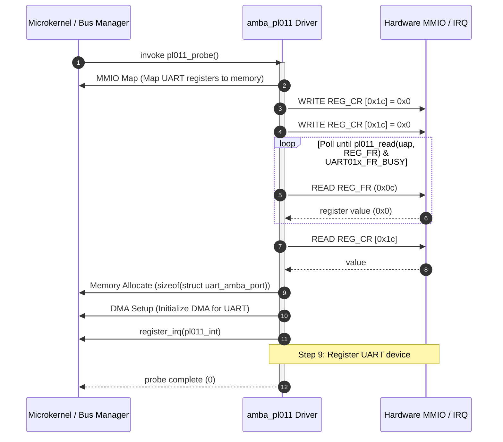
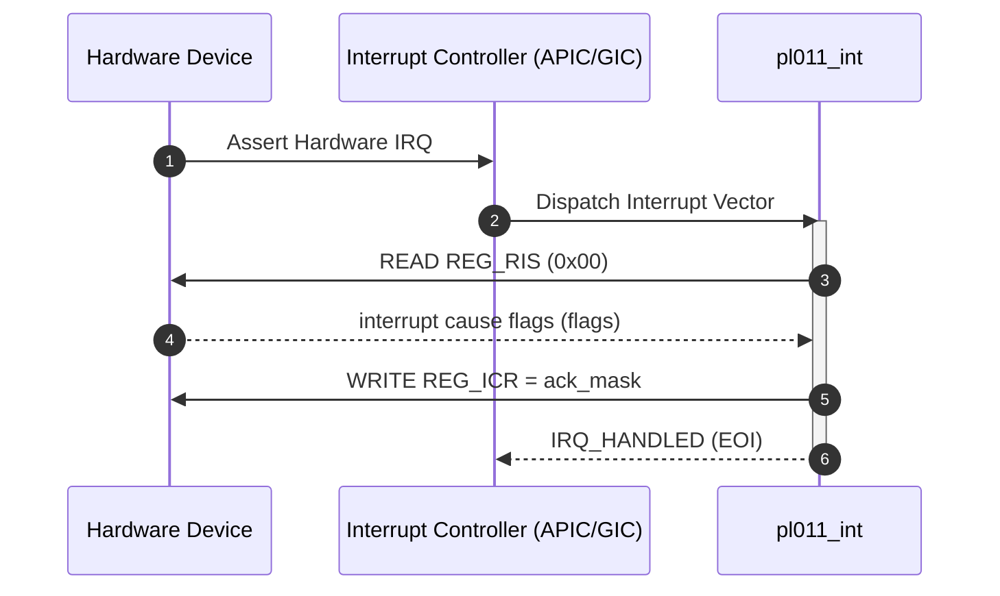

# Hardware & Driver Specification: ARM AMBA Serial Port

> **Linux Driver Module:** `amba_pl011` | **Bus Type:** `MMIO` | **Endianness:** `little`

---

## 1. Summary & Hardware Identification

ARM AMBA PL011 UART driver

- **Driver Module:** `amba_pl011`
- **Device Name:** ARM AMBA Serial Port
- **License / Author:** GPL — ARM Ltd/Deep Blue Solutions Ltd
- **Primary Driver Structs:** `platform_driver`, `uart_ops`, `uart_driver`, `console`, `of_device_id`, `acpi_device_id`, `amba_driver`
- **Probe / Remove Entry Points:** `pl011_probe` / `pl011_remove`

### Compatible Hardware Nodes & Device IDs

| Match Source | Identifier / Compatible String | Vendor ID | Device ID |
| :--- | :--- | :--- | :--- |
| Device Tree (`of_device_id`) | `arm,pl011` | — | — |

### MMIO / BAR Base Address Regions

| Region ID | Name | Base Offset | Size Hint | Description |
| :--- | :--- | :--- | :--- | :--- |
| `0` | UART Registers | `0x0` | 0x1000 | Contains all UART registers |

---

## 2. Register Memory Map

| Register Name | Offset | Offset Formula | Width | Access | Reset Value | Description |
| :--- | :--- | :--- | :--- | :--- | :--- | :--- |
| `REG_RIS` | `0x00` | — | 32-bit | `RO` | `0x0` | Raw Interrupt Status Register |
| `REG_ICR` | `0x04` | — | 32-bit | `WO` | `0x0` | Interrupt Clear Register |
| `REG_IMSC` | `0x08` | — | 32-bit | `RW` | `0x0` | Interrupt Mask Set/Clear Register |
| `REG_FR` | `0x0c` | — | 32-bit | `RO` | `0x0` | Flag Register |
| `REG_LCRH` | `0x10` | — | 32-bit | `RW` | `0x0` | Line Control Register |
| `REG_IBRD` | `0x14` | — | 16-bit | `RW` | `0x0` | Integer Baud Rate Divisor |
| `REG_FBRD` | `0x18` | — | 16-bit | `RW` | `0x0` | Fractional Baud Rate Divisor |
| `REG_CR` | `0x1c` | — | 32-bit | `RW` | `0x0` | Control Register |
| `REG_IFLS` | `0x20` | — | 32-bit | `RW` | `0x0` | Interrupt FIFO Level Select Register |

### Bitfield Definitions

#### `REG_RIS` (`0x00`)

| Bitfield | Bits | Mask / Macro | Access | Reset | Description |
| :--- | :--- | :--- | :--- | :--- | :--- |
| `UART011_TXIS` | `0` | `BIT(0)` | `RO` | `—` | Transmit Interrupt Status |
| `UART011_RTIS` | `1` | `BIT(1)` | `RO` | `—` | Receive Timeout Interrupt Status |
| `UART011_RXIS` | `2` | `BIT(2)` | `RO` | `—` | Receive Interrupt Status |
| `UART011_DSRMIS` | `3` | `BIT(3)` | `RO` | `—` | Data Set Ready Masked Interrupt Status |
| `UART011_DCDMIS` | `4` | `BIT(4)` | `RO` | `—` | Data Carrier Detect Masked Interrupt Status |
| `UART011_CTSMIS` | `5` | `BIT(5)` | `RO` | `—` | Clear To Send Masked Interrupt Status |
| `UART011_RIMIS` | `6` | `BIT(6)` | `RO` | `—` | Ring Indicator Masked Interrupt Status |
#### `REG_ICR` (`0x04`)

| Bitfield | Bits | Mask / Macro | Access | Reset | Description |
| :--- | :--- | :--- | :--- | :--- | :--- |
| `UART011_OEIS` | `0` | `BIT(0)` | `WO` | `—` | Overrun Error Interrupt Status |
| `UART011_BEIS` | `1` | `BIT(1)` | `WO` | `—` | Break Error Interrupt Status |
| `UART011_PEIS` | `2` | `BIT(2)` | `WO` | `—` | Parity Error Interrupt Status |
| `UART011_FEIS` | `3` | `BIT(3)` | `WO` | `—` | Frame Error Interrupt Status |
| `UART011_RTIS` | `4` | `BIT(4)` | `WO` | `—` | Receive Timeout Interrupt Status |
| `UART011_RXIS` | `5` | `BIT(5)` | `WO` | `—` | Receive Interrupt Status |
| `UART011_DSRMIS` | `6` | `BIT(6)` | `WO` | `—` | Data Set Ready Masked Interrupt Status |
| `UART011_DCDMIS` | `7` | `BIT(7)` | `WO` | `—` | Data Carrier Detect Masked Interrupt Status |
| `UART011_CTSMIS` | `8` | `BIT(8)` | `WO` | `—` | Clear To Send Masked Interrupt Status |
| `UART011_RIMIS` | `9` | `BIT(9)` | `WO` | `—` | Ring Indicator Masked Interrupt Status |
#### `REG_IMSC` (`0x08`)

| Bitfield | Bits | Mask / Macro | Access | Reset | Description |
| :--- | :--- | :--- | :--- | :--- | :--- |
| `UART011_TXIM` | `0` | `BIT(0)` | `RW` | `—` | Transmit Interrupt Mask |
| `UART011_RTIM` | `1` | `BIT(1)` | `RW` | `—` | Receive Timeout Interrupt Mask |
| `UART011_RXIM` | `2` | `BIT(2)` | `RW` | `—` | Receive Interrupt Mask |
| `UART011_DSRMIM` | `3` | `BIT(3)` | `RW` | `—` | Data Set Ready Masked Interrupt Mask |
| `UART011_DCDMIM` | `4` | `BIT(4)` | `RW` | `—` | Data Carrier Detect Masked Interrupt Mask |
| `UART011_CTSMIM` | `5` | `BIT(5)` | `RW` | `—` | Clear To Send Masked Interrupt Mask |
| `UART011_RIMIM` | `6` | `BIT(6)` | `RW` | `—` | Ring Indicator Masked Interrupt Mask |
#### `REG_FR` (`0x0c`)

| Bitfield | Bits | Mask / Macro | Access | Reset | Description |
| :--- | :--- | :--- | :--- | :--- | :--- |
| `UART01x_FR_TXFF` | `0` | `BIT(0)` | `RO` | `—` | Transmit FIFO Full |
| `UART01x_FR_RXFE` | `1` | `BIT(1)` | `RO` | `—` | Receive FIFO Empty |
| `UART01x_FR_BUSY` | `2` | `BIT(2)` | `RO` | `—` | Busy Flag |
| `UART01x_FR_CTS` | `3` | `BIT(3)` | `RO` | `—` | Clear To Send |
| `UART01x_FR_DSR` | `4` | `BIT(4)` | `RO` | `—` | Data Set Ready |
| `UART01x_FR_DCD` | `5` | `BIT(5)` | `RO` | `—` | Data Carrier Detect |
| `UART01x_FR_RI` | `6` | `BIT(6)` | `RO` | `—` | Ring Indicator |
| `UART01x_FR_OE` | `7` | `BIT(7)` | `RO` | `—` | Overrun Error |
| `UART01x_FR_BE` | `8` | `BIT(8)` | `RO` | `—` | Break Error |
| `UART01x_FR_PE` | `9` | `BIT(9)` | `RO` | `—` | Parity Error |
| `UART01x_FR_FE` | `10` | `BIT(10)` | `RO` | `—` | Frame Error |
| `UART01x_FR_RI` | `11` | `BIT(11)` | `RO` | `—` | Ring Indicator |
#### `REG_LCRH` (`0x10`)

| Bitfield | Bits | Mask / Macro | Access | Reset | Description |
| :--- | :--- | :--- | :--- | :--- | :--- |
| `UART01x_LCRH_WLEN` | `0:1` | `0x3` | `RW` | `—` | Word Length |
| `UART01x_LCRH_STP2` | `2` | `BIT(2)` | `RW` | `—` | Two Stop Bits |
| `UART01x_LCRH_PEN` | `3` | `BIT(3)` | `RW` | `—` | Parity Enable |
| `UART01x_LCRH_EPS` | `4` | `BIT(4)` | `RW` | `—` | Even Parity |
| `UART01x_LCRH_SPS` | `5` | `BIT(5)` | `RW` | `—` | Stick Parity Select |
| `UART01x_LCRH_FEN` | `6` | `BIT(6)` | `RW` | `—` | Enable FIFOs |
#### `REG_IBRD` (`0x14`)

| Bitfield | Bits | Mask / Macro | Access | Reset | Description |
| :--- | :--- | :--- | :--- | :--- | :--- |
| `IBRD` | `0:15` | `0xffff` | `RW` | `—` | Integer Baud Rate Divisor |
#### `REG_FBRD` (`0x18`)

| Bitfield | Bits | Mask / Macro | Access | Reset | Description |
| :--- | :--- | :--- | :--- | :--- | :--- |
| `FBRD` | `0:15` | `0xffff` | `RW` | `—` | Fractional Baud Rate Divisor |
#### `REG_CR` (`0x1c`)

| Bitfield | Bits | Mask / Macro | Access | Reset | Description |
| :--- | :--- | :--- | :--- | :--- | :--- |
| `UART011_CR_RTS` | `0` | `BIT(0)` | `RW` | `—` | Request To Send |
| `UART011_CR_DTR` | `1` | `BIT(1)` | `RW` | `—` | Data Terminal Ready |
| `UART011_CR_CTSEN` | `2` | `BIT(2)` | `RW` | `—` | Clear To Send Enable |
| `UART011_CR_RTSEN` | `3` | `BIT(3)` | `RW` | `—` | Request To Send Enable |
| `UART011_CR_RXE` | `4` | `BIT(4)` | `RW` | `—` | Receiver Enable |
| `UART011_CR_TXE` | `5` | `BIT(5)` | `RW` | `—` | Transmitter Enable |
| `UART011_CR_UARTEN` | `6` | `BIT(6)` | `RW` | `—` | UART Enable |
| `UART011_CR_OVER` | `7` | `BIT(7)` | `RW` | `—` | Over Sampling Mode |
| `UART011_CR_OVSFACT` | `8` | `BIT(8)` | `RW` | `—` | Oversampling Factor |
#### `REG_IFLS` (`0x20`)

| Bitfield | Bits | Mask / Macro | Access | Reset | Description |
| :--- | :--- | :--- | :--- | :--- | :--- |
| `UART011_IFLS_RX` | `0:2` | `0x7` | `RW` | `—` | Receive FIFO Level Select |
| `UART011_IFLS_TX` | `3:5` | `0x7` | `RW` | `—` | Transmit FIFO Level Select |

---

## 3. Sequence Diagrams

### 3.1 Initialization & Probe Lifecycle (`pl011_probe`)



### 3.2 Interrupt Handling Lifecycle (`pl011_int`)



---

## 4. Runtime Operations, DMA & Concurrency Model

### 4.1 Concurrency & Locking Primitives

| Linux Primitive | Abstract Lock Type | Protected Resources | Bare-Metal C++ Recommendation |
| :--- | :--- | :--- | :--- |
| `spin_lock_irqsave(&port->lock, flags)` | `IRQSafeSpinlock` | uap->port | Use a hardware-specific IRQ-safe spinlock |

### 4.2 DMA & Memory Coherency

- **Allocation API:** `devm_dma_alloc_coherent`
- **DMA Address Mask:** 64-bit
- **Descriptor Rings:** None
- **Memory Barriers & Coherency:** Barrier/coherency notes or null

---

## 5. C++ Microkernel Migration Notes

### 5.1 Linux Kernel to Bare-Metal C++ API Mapping

| Linux Kernel API | Bare-Metal C++ Microkernel Equivalent | Migration Notes |
| :--- | :--- | :--- |
| `readl / writel` | `MmioRegion::read32 / write32` | Use MMIO functions to access UART registers |

### 5.2 Architectural Caveats

- Ensure proper handling of interrupts and DMA operations

### 5.3 Generated C++20 Bare-Metal Driver Skeleton

```cpp
#pragma once

#include <cstdint>
#include <cstddef>

namespace microkernel::drivers::amba_pl011 {

namespace regs {
    inline constexpr std::uintptr_t REG_RIS = 0x00; // 32-bit RO - Raw Interrupt Status Register    inline constexpr std::uintptr_t REG_ICR = 0x04; // 32-bit WO - Interrupt Clear Register    inline constexpr std::uintptr_t REG_IMSC = 0x08; // 32-bit RW - Interrupt Mask Set/Clear Register    inline constexpr std::uintptr_t REG_FR = 0x0c; // 32-bit RO - Flag Register    inline constexpr std::uintptr_t REG_LCRH = 0x10; // 32-bit RW - Line Control Register    inline constexpr std::uintptr_t REG_IBRD = 0x14; // 16-bit RW - Integer Baud Rate Divisor    inline constexpr std::uintptr_t REG_FBRD = 0x18; // 16-bit RW - Fractional Baud Rate Divisor    inline constexpr std::uintptr_t REG_CR = 0x1c; // 32-bit RW - Control Register    inline constexpr std::uintptr_t REG_IFLS = 0x20; // 32-bit RW - Interrupt FIFO Level Select Register} // namespace regs

class AmbaPl011Driver {
public:
    explicit AmbaPl011Driver(std::uintptr_t mmio_base) noexcept
        : mmio_base_(mmio_base) {}

    bool init() noexcept {
        // Implement ordered initialization steps from Section 3.1 (9 steps)
        return true;
    }

    void handle_irq() noexcept {
        const auto status = read32(regs::REG_RIS);
        (void)status;
        // Acknowledge interrupt (Write-1-to-clear ICR)
        write32(regs::REG_ICR, status);
    }

private:
    [[nodiscard]] std::uint32_t read32(std::uintptr_t offset) const noexcept {
        return *reinterpret_cast<const volatile std::uint32_t*>(mmio_base_ + offset);
    }

    void write32(std::uintptr_t offset, std::uint32_t value) const noexcept {
        *reinterpret_cast<volatile std::uint32_t*>(mmio_base_ + offset) = value;
    }

    std::uintptr_t mmio_base_;
};

} // namespace microkernel::drivers::amba_pl011
```
