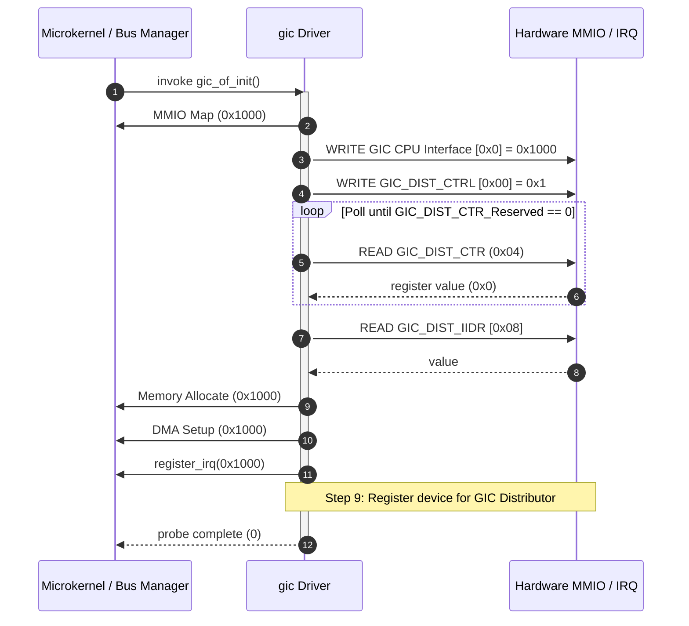
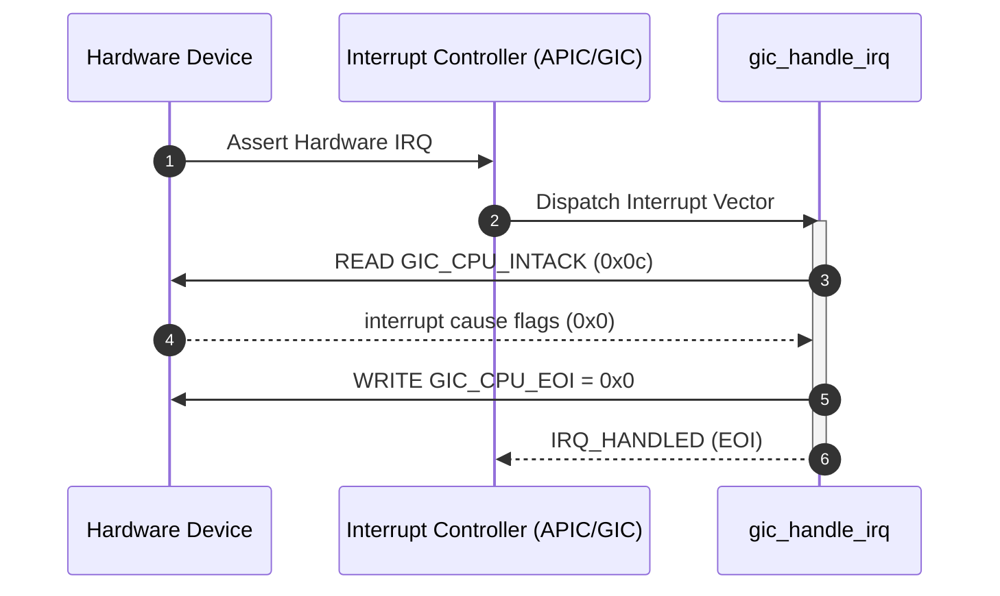

# Hardware & Driver Specification: ARM GIC

> **Linux Driver Module:** `gic` | **Bus Type:** `MMIO` | **Endianness:** `little`

---

## 1. Summary & Hardware Identification

ARM General Interrupt Controller (GIC) driver

- **Driver Module:** `gic`
- **Device Name:** ARM GIC
- **License / Author:** GPL-2.0-only — ARM Limited
- **Primary Driver Structs:** `platform_driver`, `irqchip`, `irqchip/chained_irq`, `irqchip/arm-gic`
- **Probe / Remove Entry Points:** `gic_of_init` / `gic_of_init_child`

### Compatible Hardware Nodes & Device IDs

| Match Source | Identifier / Compatible String | Vendor ID | Device ID |
| :--- | :--- | :--- | :--- |
| Device Tree (`of_device_id`) | `arm,gic-400` | — | — |
| Device Tree (`of_device_id`) | `arm,arm11mp-gic` | — | — |
| Device Tree (`of_device_id`) | `arm,arm1176jzf-devchip-gic` | — | — |
| Device Tree (`of_device_id`) | `arm,cortex-a15-gic` | — | — |
| Device Tree (`of_device_id`) | `arm,cortex-a9-gic` | — | — |
| Device Tree (`of_device_id`) | `arm,cortex-a7-gic` | — | — |
| Device Tree (`of_device_id`) | `qcom,msm-8660-qgic` | — | — |
| Device Tree (`of_device_id`) | `qcom,msm-qgic2` | — | — |
| Device Tree (`of_device_id`) | `pl390` | — | — |

### MMIO / BAR Base Address Regions

| Region ID | Name | Base Offset | Size Hint | Description |
| :--- | :--- | :--- | :--- | :--- |
| `0` | GIC Distributor | `0x0` | 0x1000 | Base address of the GIC Distributor |
| `1` | GIC CPU Interface | `0x0` | 0x1000 | Base address of the GIC CPU Interface |

---

## 2. Register Memory Map

| Register Name | Offset | Offset Formula | Width | Access | Reset Value | Description |
| :--- | :--- | :--- | :--- | :--- | :--- | :--- |
| `GIC_DIST_CTRL` | `0x0` | — | 32-bit | `RW` | `0x0` | Control register for the GIC Distributor |
| `GIC_DIST_CTR` | `0x4` | — | 32-bit | `RO` | `0x0` | Counter register for the GIC Distributor |
| `GIC_DIST_IIDR` | `0x8` | — | 32-bit | `RO` | `0x0` | Identification register for the GIC Distributor |
| `GIC_DIST_IGROUP` | `0x80` | — | 32-bit | `RW` | `0x0` | Interrupt group register for the GIC Distributor |
| `GIC_DIST_PENDING_SET` | `0x200` | — | 32-bit | `RW` | `0x0` | Pending set register for the GIC Distributor |
| `GIC_DIST_PENDING_CLEAR` | `0x280` | — | 32-bit | `RW` | `0x0` | Pending clear register for the GIC Distributor |
| `GIC_DIST_ACTIVE_SET` | `0x300` | — | 32-bit | `RW` | `0x0` | Active set register for the GIC Distributor |
| `GIC_DIST_ACTIVE_CLEAR` | `0x380` | — | 32-bit | `RW` | `0x0` | Active clear register for the GIC Distributor |
| `GIC_DIST_PRI` | `0x400` | — | 32-bit | `RW` | `0x0` | Priority register for the GIC Distributor |
| `GIC_DIST_TARGET` | `0x800` | — | 32-bit | `RW` | `0x0` | Target register for the GIC Distributor |
| `GIC_DIST_CONFIG` | `0xc00` | — | 32-bit | `RW` | `0x0` | Configuration register for the GIC Distributor |
| `GIC_DIST_SOFTINT` | `0xf00` | — | 32-bit | `RW` | `0x0` | Software interrupt register for the GIC Distributor |
| `GIC_DIST_SGI_PENDING_CLEAR` | `0xf10` | — | 32-bit | `RW` | `0x0` | SGI pending clear register for the GIC Distributor |
| `GIC_DIST_SGI_PENDING_SET` | `0xf20` | — | 32-bit | `RW` | `0x0` | SGI pending set register for the GIC Distributor |
| `GICD_ENABLE` | `0x1` | — | 32-bit | `RW` | `0x0` | Enable the GIC Distributor |
| `GICD_DISABLE` | `0x0` | — | 32-bit | `RW` | `0x0` | Disable the GIC Distributor |
| `GICD_INT_ACTLOW_LVLTRIG` | `0x0` | — | 32-bit | `RW` | `0x0` | Interrupt activation low level trigger |
| `GICD_INT_EN_CLR_X32` | `0xffffffff` | — | 32-bit | `RW` | `0xffffffff` | Interrupt enable clear X32 |
| `GICD_INT_EN_SET_SGI` | `0xffff` | — | 32-bit | `RW` | `0xffff` | Interrupt enable set SGI |
| `GICD_INT_EN_CLR_PPI` | `0xffff0000` | — | 32-bit | `RW` | `0xffff0000` | Interrupt enable clear PPI |
| `GICH_HCR` | `0x0` | — | 32-bit | `RW` | `0x0` | HCR register for the GIC Distributor |
| `GICH_VTR` | `0x4` | — | 32-bit | `RW` | `0x0` | VTR register for the GIC Distributor |
| `GICH_VMCR` | `0x8` | — | 32-bit | `RW` | `0x0` | VMCR register for the GIC Distributor |
| `GICH_MISR` | `0x10` | — | 32-bit | `RO` | `0x0` | MISR register for the GIC Distributor |
| `GICH_EISR0` | `0x20` | — | 32-bit | `RW` | `0x0` | EISR0 register for the GIC Distributor |
| `GICH_EISR1` | `0x24` | — | 32-bit | `RW` | `0x0` | EISR1 register for the GIC Distributor |
| `GICH_ELRSR0` | `0x30` | — | 32-bit | `RW` | `0x0` | ELRSR0 register for the GIC Distributor |
| `GICH_ELRSR1` | `0x34` | — | 32-bit | `RW` | `0x0` | ELRSR1 register for the GIC Distributor |
| `GICH_APR` | `0xf0` | — | 32-bit | `RW` | `0x0` | APR register for the GIC Distributor |
| `GICH_LR0` | `0x100` | — | 32-bit | `RW` | `0x0` | LR0 register for the GIC Distributor |

### Bitfield Definitions

#### `GIC_DIST_CTRL` (`0x0`)

| Bitfield | Bits | Mask / Macro | Access | Reset | Description |
| :--- | :--- | :--- | :--- | :--- | :--- |
| `GIC_DIST_CTRL_ENABLE` | `0` | `0x1` | `RW` | `—` | Enable the GIC Distributor |
#### `GIC_DIST_CTR` (`0x4`)

| Bitfield | Bits | Mask / Macro | Access | Reset | Description |
| :--- | :--- | :--- | :--- | :--- | :--- |
| `GIC_DIST_CTR_Reserved` | `0` | `0x3f` | `RO` | `—` | Reserved bits |
#### `GIC_DIST_IIDR` (`0x8`)

| Bitfield | Bits | Mask / Macro | Access | Reset | Description |
| :--- | :--- | :--- | :--- | :--- | :--- |
| `GICD_IIDR_IMPLEMENTER` | `0` | `0xfff` | `RO` | `—` | Implementer code |
| `GICD_IIDR_REVISION` | `12` | `0xf000` | `RO` | `—` | Revision code |
| `GICD_IIDR_VARIANT` | `16` | `0xf0000` | `RO` | `—` | Variant code |
| `GICD_IIDR_PRODUCT_ID` | `24` | `0xff000000` | `RO` | `—` | Product ID |
#### `GIC_DIST_IGROUP` (`0x80`)

| Bitfield | Bits | Mask / Macro | Access | Reset | Description |
| :--- | :--- | :--- | :--- | :--- | :--- |
| `GIC_DIST_IGROUP_Reserved` | `0` | `0xffffffff` | `RW` | `—` | Reserved bits |
#### `GIC_DIST_PENDING_SET` (`0x200`)

| Bitfield | Bits | Mask / Macro | Access | Reset | Description |
| :--- | :--- | :--- | :--- | :--- | :--- |
| `GIC_DIST_PENDING_SET_Reserved` | `0` | `0xffffffff` | `RW` | `—` | Reserved bits |
#### `GIC_DIST_PENDING_CLEAR` (`0x280`)

| Bitfield | Bits | Mask / Macro | Access | Reset | Description |
| :--- | :--- | :--- | :--- | :--- | :--- |
| `GIC_DIST_PENDING_CLEAR_Reserved` | `0` | `0xffffffff` | `RW` | `—` | Reserved bits |
#### `GIC_DIST_ACTIVE_SET` (`0x300`)

| Bitfield | Bits | Mask / Macro | Access | Reset | Description |
| :--- | :--- | :--- | :--- | :--- | :--- |
| `GIC_DIST_ACTIVE_SET_Reserved` | `0` | `0xffffffff` | `RW` | `—` | Reserved bits |
#### `GIC_DIST_ACTIVE_CLEAR` (`0x380`)

| Bitfield | Bits | Mask / Macro | Access | Reset | Description |
| :--- | :--- | :--- | :--- | :--- | :--- |
| `GIC_DIST_ACTIVE_CLEAR_Reserved` | `0` | `0xffffffff` | `RW` | `—` | Reserved bits |
#### `GIC_DIST_PRI` (`0x400`)

| Bitfield | Bits | Mask / Macro | Access | Reset | Description |
| :--- | :--- | :--- | :--- | :--- | :--- |
| `GIC_DIST_PRI_Reserved` | `0` | `0xffffffff` | `RW` | `—` | Reserved bits |
#### `GIC_DIST_TARGET` (`0x800`)

| Bitfield | Bits | Mask / Macro | Access | Reset | Description |
| :--- | :--- | :--- | :--- | :--- | :--- |
| `GIC_DIST_TARGET_Reserved` | `0` | `0xffffffff` | `RW` | `—` | Reserved bits |
#### `GIC_DIST_CONFIG` (`0xc00`)

| Bitfield | Bits | Mask / Macro | Access | Reset | Description |
| :--- | :--- | :--- | :--- | :--- | :--- |
| `GIC_DIST_CONFIG_Reserved` | `0` | `0xffffffff` | `RW` | `—` | Reserved bits |
#### `GIC_DIST_SOFTINT` (`0xf00`)

| Bitfield | Bits | Mask / Macro | Access | Reset | Description |
| :--- | :--- | :--- | :--- | :--- | :--- |
| `GIC_DIST_SOFTINT_Reserved` | `0` | `0xffffffff` | `RW` | `—` | Reserved bits |
#### `GIC_DIST_SGI_PENDING_CLEAR` (`0xf10`)

| Bitfield | Bits | Mask / Macro | Access | Reset | Description |
| :--- | :--- | :--- | :--- | :--- | :--- |
| `GIC_DIST_SGI_PENDING_CLEAR_Reserved` | `0` | `0xffffffff` | `RW` | `—` | Reserved bits |
#### `GIC_DIST_SGI_PENDING_SET` (`0xf20`)

| Bitfield | Bits | Mask / Macro | Access | Reset | Description |
| :--- | :--- | :--- | :--- | :--- | :--- |
| `GIC_DIST_SGI_PENDING_SET_Reserved` | `0` | `0xffffffff` | `RW` | `—` | Reserved bits |
#### `GICD_ENABLE` (`0x1`)

| Bitfield | Bits | Mask / Macro | Access | Reset | Description |
| :--- | :--- | :--- | :--- | :--- | :--- |
| `GICD_ENABLE_Reserved` | `0` | `0x1` | `RW` | `—` | Reserved bits |
#### `GICD_DISABLE` (`0x0`)

| Bitfield | Bits | Mask / Macro | Access | Reset | Description |
| :--- | :--- | :--- | :--- | :--- | :--- |
| `GICD_DISABLE_Reserved` | `0` | `0x1` | `RW` | `—` | Reserved bits |
#### `GICD_INT_ACTLOW_LVLTRIG` (`0x0`)

| Bitfield | Bits | Mask / Macro | Access | Reset | Description |
| :--- | :--- | :--- | :--- | :--- | :--- |
| `GICD_INT_ACTLOW_LVLTRIG_Reserved` | `0` | `0x1` | `RW` | `—` | Reserved bits |
#### `GICD_INT_EN_CLR_X32` (`0xffffffff`)

| Bitfield | Bits | Mask / Macro | Access | Reset | Description |
| :--- | :--- | :--- | :--- | :--- | :--- |
| `GICD_INT_EN_CLR_X32_Reserved` | `0` | `0xffffffff` | `RW` | `—` | Reserved bits |
#### `GICD_INT_EN_SET_SGI` (`0xffff`)

| Bitfield | Bits | Mask / Macro | Access | Reset | Description |
| :--- | :--- | :--- | :--- | :--- | :--- |
| `GICD_INT_EN_SET_SGI_Reserved` | `0` | `0xffff` | `RW` | `—` | Reserved bits |
#### `GICD_INT_EN_CLR_PPI` (`0xffff0000`)

| Bitfield | Bits | Mask / Macro | Access | Reset | Description |
| :--- | :--- | :--- | :--- | :--- | :--- |
| `GICD_INT_EN_CLR_PPI_Reserved` | `0` | `0xffff0000` | `RW` | `—` | Reserved bits |
#### `GICH_HCR` (`0x0`)

| Bitfield | Bits | Mask / Macro | Access | Reset | Description |
| :--- | :--- | :--- | :--- | :--- | :--- |
| `GICH_HCR_EN` | `0` | `0x1` | `RW` | `—` | Enable the GICH |
| `GICH_HCR_UIE` | `1` | `0x2` | `RW` | `—` | Unmasked interrupt enable |
| `GICH_HCR_LRENPIE` | `2` | `0x4` | `RW` | `—` | Level-redundant event notification interrupt enable |
| `GICH_HCR_NPIE` | `3` | `0x8` | `RW` | `—` | Non-priority interrupt enable |
| `GICH_HCR_VGrp0EIE` | `4` | `0x10` | `RW` | `—` | Virtual group 0 edge interrupt enable |
| `GICH_HCR_VGrp0DIE` | `5` | `0x20` | `RW` | `—` | Virtual group 0 deferred interrupt enable |
| `GICH_HCR_VGrp1EIE` | `6` | `0x40` | `RW` | `—` | Virtual group 1 edge interrupt enable |
| `GICH_HCR_VGrp1DIE` | `7` | `0x80` | `RW` | `—` | Virtual group 1 deferred interrupt enable |
| `GICH_HCR_EOICOUNT` | `31:27` | `0xf8000000` | `RW` | `—` | EOI count |
#### `GICH_VTR` (`0x4`)

| Bitfield | Bits | Mask / Macro | Access | Reset | Description |
| :--- | :--- | :--- | :--- | :--- | :--- |
| `GICH_VTR_Reserved` | `0` | `0xffffffff` | `RW` | `—` | Reserved bits |
#### `GICH_VMCR` (`0x8`)

| Bitfield | Bits | Mask / Macro | Access | Reset | Description |
| :--- | :--- | :--- | :--- | :--- | :--- |
| `GICH_VMCR_ENABLE_GRP0` | `0` | `0x1` | `RW` | `—` | Enable virtual group 0 |
| `GICH_VMCR_ENABLE_GRP1` | `1` | `0x2` | `RW` | `—` | Enable virtual group 1 |
| `GICH_VMCR_ACK_CTL` | `2` | `0x4` | `RW` | `—` | Acknowledge control |
| `GICH_VMCR_FIQ_EN` | `3` | `0x8` | `RW` | `—` | FIQ enable |
| `GICH_VMCR_CBPR` | `4` | `0x10` | `RW` | `—` | CBPR |
| `GICH_VMCR_EOI_MODE` | `9` | `0x200` | `RW` | `—` | EOI mode |
| `GICH_VMCR_PRIMASK` | `27:24` | `0xf8000000` | `RW` | `—` | Primary mask |
| `GICH_VMCR_BINPOINT` | `21:18` | `0x70000` | `RW` | `—` | Binpoint |
| `GICH_VMCR_ALIAS_BINPOINT` | `18:15` | `0x700` | `RW` | `—` | Alias binpoint |
#### `GICH_MISR` (`0x10`)

| Bitfield | Bits | Mask / Macro | Access | Reset | Description |
| :--- | :--- | :--- | :--- | :--- | :--- |
| `GICH_MISR_EOI` | `0` | `0x1` | `RO` | `—` | EOI |
| `GICH_MISR_U` | `1` | `0x2` | `RO` | `—` | U |
#### `GICH_EISR0` (`0x20`)

| Bitfield | Bits | Mask / Macro | Access | Reset | Description |
| :--- | :--- | :--- | :--- | :--- | :--- |
| `GICH_EISR0_Reserved` | `0` | `0xffffffff` | `RW` | `—` | Reserved bits |
#### `GICH_EISR1` (`0x24`)

| Bitfield | Bits | Mask / Macro | Access | Reset | Description |
| :--- | :--- | :--- | :--- | :--- | :--- |
| `GICH_EISR1_Reserved` | `0` | `0xffffffff` | `RW` | `—` | Reserved bits |
#### `GICH_ELRSR0` (`0x30`)

| Bitfield | Bits | Mask / Macro | Access | Reset | Description |
| :--- | :--- | :--- | :--- | :--- | :--- |
| `GICH_ELRSR0_Reserved` | `0` | `0xffffffff` | `RW` | `—` | Reserved bits |
#### `GICH_ELRSR1` (`0x34`)

| Bitfield | Bits | Mask / Macro | Access | Reset | Description |
| :--- | :--- | :--- | :--- | :--- | :--- |
| `GICH_ELRSR1_Reserved` | `0` | `0xffffffff` | `RW` | `—` | Reserved bits |
#### `GICH_APR` (`0xf0`)

| Bitfield | Bits | Mask / Macro | Access | Reset | Description |
| :--- | :--- | :--- | :--- | :--- | :--- |
| `GICH_APR_Reserved` | `0` | `0xffffffff` | `RW` | `—` | Reserved bits |
#### `GICH_LR0` (`0x100`)

| Bitfield | Bits | Mask / Macro | Access | Reset | Description |
| :--- | :--- | :--- | :--- | :--- | :--- |
| `GICH_LR0_VIRTUALID` | `0:7` | `0x3ff` | `RW` | `—` | Virtual ID |
| `GICH_LR_PHYSID_CPUID` | `10:17` | `0x3ff` | `RW` | `—` | Physical ID CPUID |
| `GICH_LR_PRIORITY` | `23:20` | `0x1f` | `RW` | `—` | Priority |
| `GICH_LR_STATE` | `28` | `0x3` | `RW` | `—` | State |
| `GICH_LR_PENDING_BIT` | `28` | `0x1` | `RW` | `—` | Pending bit |
| `GICH_LR_ACTIVE_BIT` | `29` | `0x1` | `RW` | `—` | Active bit |
| `GICH_LR_EOI` | `19` | `0x1` | `RW` | `—` | EOI |
| `GICH_LR_GROUP1` | `30` | `0x1` | `RW` | `—` | Group 1 |
| `GICH_LR_HW` | `31` | `0x1` | `RW` | `—` | HW |

---

## 3. Sequence Diagrams

### 3.1 Initialization & Probe Lifecycle (`gic_of_init`)



### 3.2 Interrupt Handling Lifecycle (`gic_handle_irq`)



---

## 4. Runtime Operations, DMA & Concurrency Model

### 4.1 Concurrency & Locking Primitives

| Linux Primitive | Abstract Lock Type | Protected Resources | Bare-Metal C++ Recommendation |
| :--- | :--- | :--- | :--- |
| `spin_lock_irqsave(&cpu_map_lock, (f))` | `IRQSafeSpinlock` | GIC CPU Interface | Use IRQSafeSpinlock for critical sections |

### 4.2 DMA & Memory Coherency

- **Allocation API:** `dma_alloc_coherent`
- **DMA Address Mask:** 64-bit
- **Descriptor Rings:** None
- **Memory Barriers & Coherency:** Barrier/coherency notes or null

---

## 5. C++ Microkernel Migration Notes

### 5.1 Linux Kernel to Bare-Metal C++ API Mapping

| Linux Kernel API | Bare-Metal C++ Microkernel Equivalent | Migration Notes |
| :--- | :--- | :--- |
| `readl / writel` | `MmioRegion::read32 / write32` | Use MmioRegion::read32 / write32 for accessing GIC registers |

### 5.2 Architectural Caveats

- Ensure proper synchronization between GIC operations

### 5.3 Generated C++20 Bare-Metal Driver Skeleton

```cpp
#pragma once

#include <cstdint>
#include <cstddef>

namespace microkernel::drivers::gic {

namespace regs {
    inline constexpr std::uintptr_t GIC_DIST_CTRL = 0x0; // 32-bit RW - Control register for the GIC Distributor    inline constexpr std::uintptr_t GIC_DIST_CTR = 0x4; // 32-bit RO - Counter register for the GIC Distributor    inline constexpr std::uintptr_t GIC_DIST_IIDR = 0x8; // 32-bit RO - Identification register for the GIC Distributor    inline constexpr std::uintptr_t GIC_DIST_IGROUP = 0x80; // 32-bit RW - Interrupt group register for the GIC Distributor    inline constexpr std::uintptr_t GIC_DIST_PENDING_SET = 0x200; // 32-bit RW - Pending set register for the GIC Distributor    inline constexpr std::uintptr_t GIC_DIST_PENDING_CLEAR = 0x280; // 32-bit RW - Pending clear register for the GIC Distributor    inline constexpr std::uintptr_t GIC_DIST_ACTIVE_SET = 0x300; // 32-bit RW - Active set register for the GIC Distributor    inline constexpr std::uintptr_t GIC_DIST_ACTIVE_CLEAR = 0x380; // 32-bit RW - Active clear register for the GIC Distributor    inline constexpr std::uintptr_t GIC_DIST_PRI = 0x400; // 32-bit RW - Priority register for the GIC Distributor    inline constexpr std::uintptr_t GIC_DIST_TARGET = 0x800; // 32-bit RW - Target register for the GIC Distributor    inline constexpr std::uintptr_t GIC_DIST_CONFIG = 0xc00; // 32-bit RW - Configuration register for the GIC Distributor    inline constexpr std::uintptr_t GIC_DIST_SOFTINT = 0xf00; // 32-bit RW - Software interrupt register for the GIC Distributor    inline constexpr std::uintptr_t GIC_DIST_SGI_PENDING_CLEAR = 0xf10; // 32-bit RW - SGI pending clear register for the GIC Distributor    inline constexpr std::uintptr_t GIC_DIST_SGI_PENDING_SET = 0xf20; // 32-bit RW - SGI pending set register for the GIC Distributor    inline constexpr std::uintptr_t GICD_ENABLE = 0x1; // 32-bit RW - Enable the GIC Distributor    inline constexpr std::uintptr_t GICD_DISABLE = 0x0; // 32-bit RW - Disable the GIC Distributor    inline constexpr std::uintptr_t GICD_INT_ACTLOW_LVLTRIG = 0x0; // 32-bit RW - Interrupt activation low level trigger    inline constexpr std::uintptr_t GICD_INT_EN_CLR_X32 = 0xffffffff; // 32-bit RW - Interrupt enable clear X32    inline constexpr std::uintptr_t GICD_INT_EN_SET_SGI = 0xffff; // 32-bit RW - Interrupt enable set SGI    inline constexpr std::uintptr_t GICD_INT_EN_CLR_PPI = 0xffff0000; // 32-bit RW - Interrupt enable clear PPI    inline constexpr std::uintptr_t GICH_HCR = 0x0; // 32-bit RW - HCR register for the GIC Distributor    inline constexpr std::uintptr_t GICH_VTR = 0x4; // 32-bit RW - VTR register for the GIC Distributor    inline constexpr std::uintptr_t GICH_VMCR = 0x8; // 32-bit RW - VMCR register for the GIC Distributor    inline constexpr std::uintptr_t GICH_MISR = 0x10; // 32-bit RO - MISR register for the GIC Distributor    inline constexpr std::uintptr_t GICH_EISR0 = 0x20; // 32-bit RW - EISR0 register for the GIC Distributor    inline constexpr std::uintptr_t GICH_EISR1 = 0x24; // 32-bit RW - EISR1 register for the GIC Distributor    inline constexpr std::uintptr_t GICH_ELRSR0 = 0x30; // 32-bit RW - ELRSR0 register for the GIC Distributor    inline constexpr std::uintptr_t GICH_ELRSR1 = 0x34; // 32-bit RW - ELRSR1 register for the GIC Distributor    inline constexpr std::uintptr_t GICH_APR = 0xf0; // 32-bit RW - APR register for the GIC Distributor    inline constexpr std::uintptr_t GICH_LR0 = 0x100; // 32-bit RW - LR0 register for the GIC Distributor} // namespace regs

class GicDriver {
public:
    explicit GicDriver(std::uintptr_t mmio_base) noexcept
        : mmio_base_(mmio_base) {}

    bool init() noexcept {
        // Implement ordered initialization steps from Section 3.1 (9 steps)
        return true;
    }

    void handle_irq() noexcept {
        const auto status = read32(regs::GIC_CPU_INTACK);
        (void)status;
        // Acknowledge interrupt (Write-1-to-clear ICR)
        write32(regs::GIC_CPU_EOI, status);
    }

private:
    [[nodiscard]] std::uint32_t read32(std::uintptr_t offset) const noexcept {
        return *reinterpret_cast<const volatile std::uint32_t*>(mmio_base_ + offset);
    }

    void write32(std::uintptr_t offset, std::uint32_t value) const noexcept {
        *reinterpret_cast<volatile std::uint32_t*>(mmio_base_ + offset) = value;
    }

    std::uintptr_t mmio_base_;
};

} // namespace microkernel::drivers::gic
```
