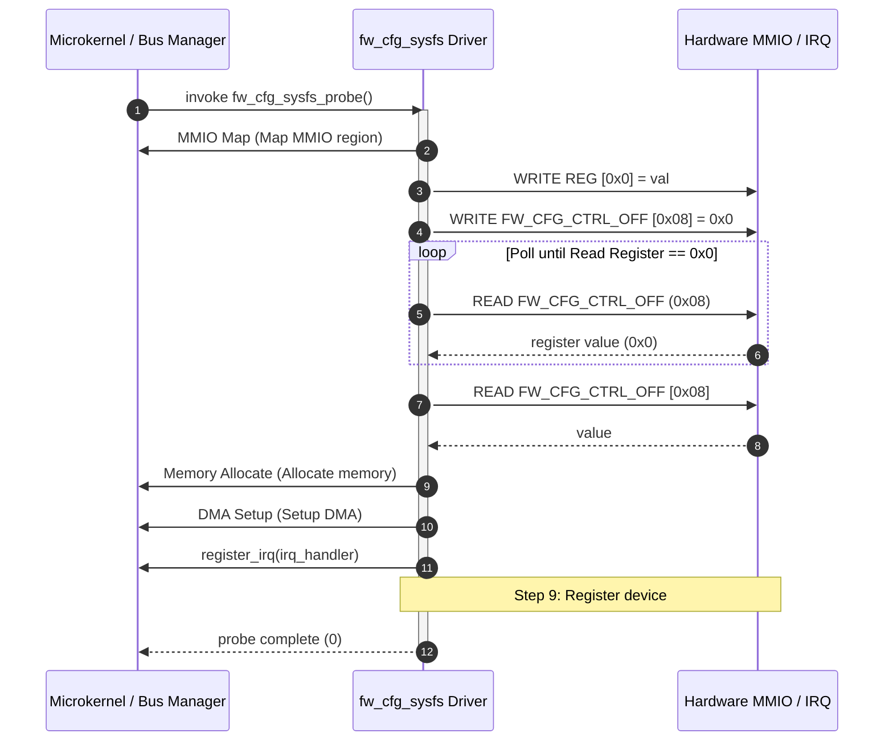
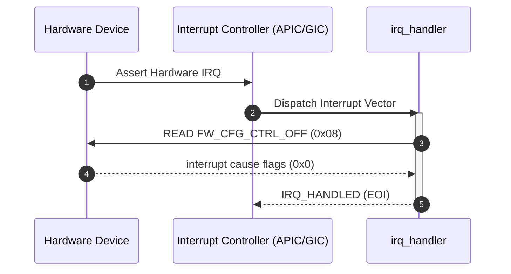

# Hardware & Driver Specification: QEMU fw_cfg sysfs support

> **Linux Driver Module:** `fw_cfg_sysfs` | **Bus Type:** `MMIO` | **Endianness:** `little`

---

## 1. Summary & Hardware Identification

QEMU fw_cfg sysfs support

- **Driver Module:** `fw_cfg_sysfs`
- **Device Name:** QEMU fw_cfg sysfs support
- **License / Author:** GPL — Gabriel L. Somlo <somlo@cmu.edu>- **Primary Driver Structs:** `of_device_id`, `acpi_device_id`, `platform_driver`- **Probe / Remove Entry Points:** `fw_cfg_sysfs_probe` / `fw_cfg_sysfs_remove`

### Compatible Hardware Nodes & Device IDs

| Match Source | Identifier / Compatible String | Vendor ID | Device ID |
| :--- | :--- | :--- | :--- |
| Device Tree (`of_device_id`) | `qemu,fw-cfg-mmio` | — | — |

### MMIO / BAR Base Address Regions

| Region ID | Name | Base Offset | Size Hint | Description |
| :--- | :--- | :--- | :--- | :--- |
| `0` | I/O Range | `0x0` | 0x1000 | MMIO region for fw_cfg |

---

## 2. Register Memory Map

| Register Name | Offset | Offset Formula | Width | Access | Reset Value | Description |
| :--- | :--- | :--- | :--- | :--- | :--- | :--- |
| `FW_CFG_CTRL_OFF` | `0x0` | — | 32-bit | `RW` | `0x0` | Control register for fw_cfg |

### Bitfield Definitions

#### `FW_CFG_CTRL_OFF` (`0x0`)

| Bitfield | Bits | Mask / Macro | Access | Reset | Description |
| :--- | :--- | :--- | :--- | :--- | :--- |
| `FW_CFG_CTRL_OFF` | `0` | `BIT(0)` | `RW` | `—` | Control register bit |

---

## 3. Sequence Diagrams

### 3.1 Initialization & Probe Lifecycle (`fw_cfg_sysfs_probe`)



### 3.2 Interrupt Handling Lifecycle (`irq_handler`)



---

## 4. Runtime Operations, DMA & Concurrency Model

### 4.1 Concurrency & Locking Primitives

| Linux Primitive | Abstract Lock Type | Protected Resources | Bare-Metal C++ Recommendation |
| :--- | :--- | :--- | :--- |
| `spin_lock_irqsave(&fw_cfg_dev_lock, flags)` | `Spinlock` | fw_cfg_dev_lock | Use a Spinlock or equivalent primitive |

### 4.2 DMA & Memory Coherency

- **Allocation API:** `dma_alloc_coherent`
- **DMA Address Mask:** 64-bit
- **Descriptor Rings:** None
- **Memory Barriers & Coherency:** Use explicit store/load barriers (`std::atomic_thread_fence`) before updating hardware tail pointers.

---

## 5. C++ Microkernel Migration Notes

### 5.1 Linux Kernel to Bare-Metal C++ API Mapping

| Linux Kernel API | Bare-Metal C++ Microkernel Equivalent | Migration Notes |
| :--- | :--- | :--- |
| `ioread8 / iowrite8` | `MmioRegion::read8 / write8` | Use bare-metal equivalents for MMIO operations |
| `ioread16 / iowrite16` | `MmioRegion::read16 / write16` | Use bare-metal equivalents for MMIO operations |
| `ioread32 / iowrite32` | `MmioRegion::read32 / write32` | Use bare-metal equivalents for MMIO operations |

### 5.2 Architectural Caveats

- Ensure proper synchronization for shared resources

### 5.3 Generated C++20 Bare-Metal Driver Skeleton

```cpp
#pragma once

#include <cstdint>
#include <cstddef>

namespace microkernel::drivers::fw_cfg_sysfs {

namespace regs {
    inline constexpr std::uintptr_t FW_CFG_CTRL_OFF = 0x0; // 32-bit RW - Control register for fw_cfg} // namespace regs

class FwCfgSysfsDriver {
public:
    explicit FwCfgSysfsDriver(std::uintptr_t mmio_base) noexcept
        : mmio_base_(mmio_base) {}

    bool init() noexcept {
        // Implement ordered initialization steps from Section 3.1 (9 steps)
        return true;
    }

    void handle_irq() noexcept {
    }

private:
    [[nodiscard]] std::uint32_t read32(std::uintptr_t offset) const noexcept {
        return *reinterpret_cast<const volatile std::uint32_t*>(mmio_base_ + offset);
    }

    void write32(std::uintptr_t offset, std::uint32_t value) const noexcept {
        *reinterpret_cast<volatile std::uint32_t*>(mmio_base_ + offset) = value;
    }

    std::uintptr_t mmio_base_;
};

} // namespace microkernel::drivers::fw_cfg_sysfs
```
