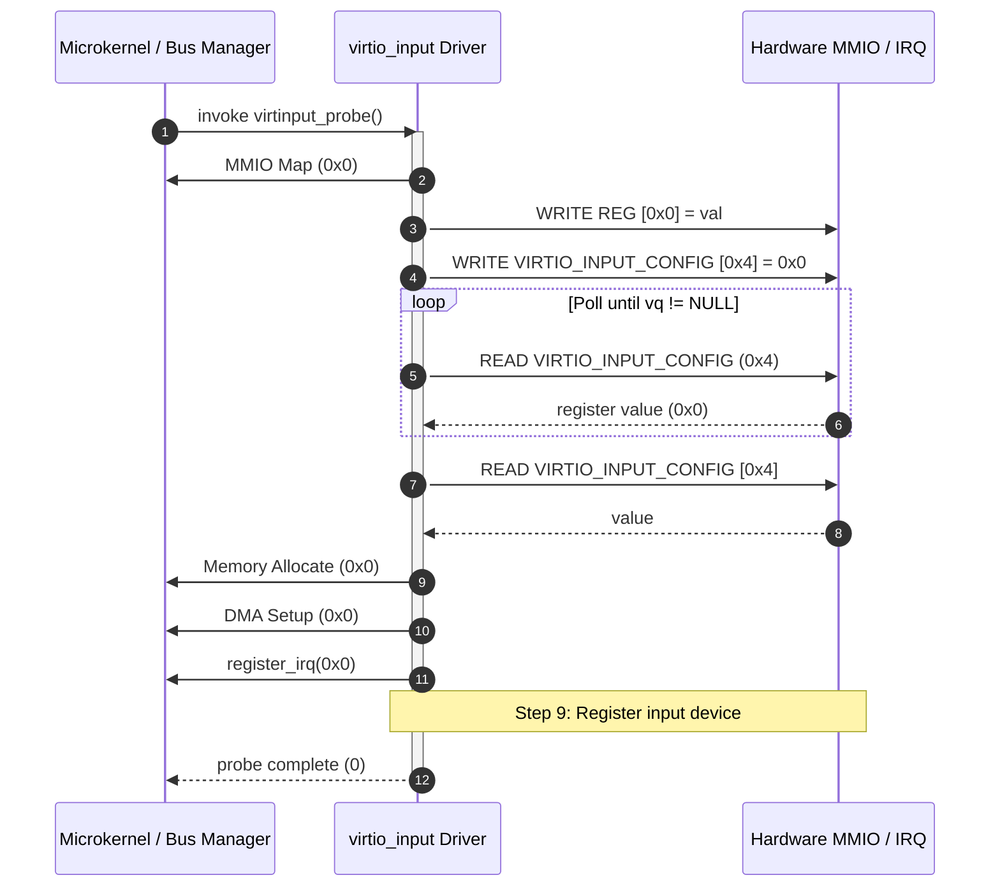
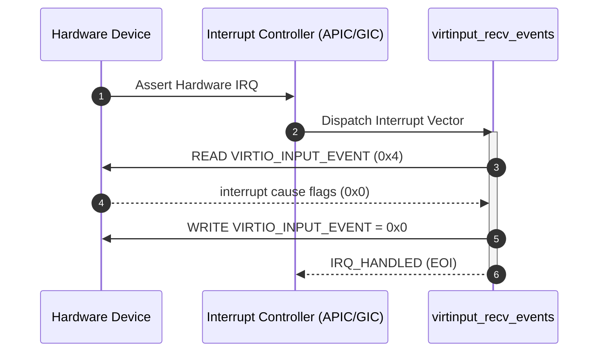

# Hardware & Driver Specification: Virtio Input Device

> **Linux Driver Module:** `virtio_input` | **Bus Type:** `MMIO` | **Endianness:** `little`

---

## 1. Summary & Hardware Identification

Virtio Input Device Driver

- **Driver Module:** `virtio_input`
- **Device Name:** Virtio Input Device
- **License / Author:** GPL — Gerd Hoffmann <kraxel@redhat.com>- **Primary Driver Structs:** `virtio_driver`, `input_dev`, `virtio_device`- **Probe / Remove Entry Points:** `virtinput_probe` / `virtinput_remove`

### Compatible Hardware Nodes & Device IDs

| Match Source | Identifier / Compatible String | Vendor ID | Device ID |
| :--- | :--- | :--- | :--- |
| Device Tree (`of_device_id`) | `virtio,input` | — | — |

### MMIO / BAR Base Address Regions

| Region ID | Name | Base Offset | Size Hint | Description |
| :--- | :--- | :--- | :--- | :--- |
| `0` | Virtio Input MMIO Region | `0x0` | 0x1000 | MMIO region for Virtio Input device |

---

## 2. Register Memory Map

| Register Name | Offset | Offset Formula | Width | Access | Reset Value | Description |
| :--- | :--- | :--- | :--- | :--- | :--- | :--- |
| `VIRTIO_INPUT_CONFIG_SELECT` | `0x0` | — | 8-bit | `RO` | `0x0` | Configuration select register |
| `VIRTIO_INPUT_CONFIG` | `0x4` | — | 128-bit | `RW` | `0x0` | Configuration register |
| `VIRTIO_INPUT_ABSINFO` | `0x4` | — | 32-bit | `RW` | `0x0` | Absolute information register |
| `VIRTIO_INPUT_DEVIDS` | `0x4` | — | 32-bit | `RW` | `0x0` | Device ID register |
| `VIRTIO_INPUT_EVENT` | `0x4` | — | 32-bit | `RW` | `0x0` | Input event register |

### Bitfield Definitions

#### `VIRTIO_INPUT_CONFIG_SELECT` (`0x0`)

| Bitfield | Bits | Mask / Macro | Access | Reset | Description |
| :--- | :--- | :--- | :--- | :--- | :--- |
| `VIRTIO_INPUT_CFG_UNSET` | `0` | `0x0` | `RO` | `—` | Unset configuration |
| `VIRTIO_INPUT_CFG_ID_NAME` | `1` | `0x1` | `RO` | `—` | Device name configuration |
| `VIRTIO_INPUT_CFG_ID_SERIAL` | `2` | `0x2` | `RO` | `—` | Device serial configuration |
| `VIRTIO_INPUT_CFG_ID_DEVIDS` | `3` | `0x4` | `RO` | `—` | Device ID configuration |
| `VIRTIO_INPUT_CFG_PROP_BITS` | `16` | `0x10` | `RO` | `—` | Property bits configuration |
| `VIRTIO_INPUT_CFG_EV_BITS` | `17` | `0x11` | `RO` | `—` | Event bits configuration |
| `VIRTIO_INPUT_CFG_ABS_INFO` | `18` | `0x12` | `RO` | `—` | Absolute information configuration |
#### `VIRTIO_INPUT_CONFIG` (`0x4`)

| Bitfield | Bits | Mask / Macro | Access | Reset | Description |
| :--- | :--- | :--- | :--- | :--- | :--- |
| `select` | `0:7` | `0xFF` | `RW` | `—` | Select configuration |
| `subsel` | `8:15` | `0xFF` | `RW` | `—` | Sub-select configuration |
| `size` | `16:23` | `0xFF` | `RW` | `—` | Size configuration |
| `reserved` | `24:31` | `0xFF` | `RW` | `—` | Reserved configuration |
#### `VIRTIO_INPUT_ABSINFO` (`0x4`)

| Bitfield | Bits | Mask / Macro | Access | Reset | Description |
| :--- | :--- | :--- | :--- | :--- | :--- |
| `min` | `0:31` | `0xFFFFFFFF` | `RW` | `—` | Minimum value |
#### `VIRTIO_INPUT_DEVIDS` (`0x4`)

| Bitfield | Bits | Mask / Macro | Access | Reset | Description |
| :--- | :--- | :--- | :--- | :--- | :--- |
| `bustype` | `0:15` | `0xFFFF` | `RW` | `—` | Bus type |
| `vendor` | `16:31` | `0xFFFF` | `RW` | `—` | Vendor ID |
#### `VIRTIO_INPUT_EVENT` (`0x4`)

| Bitfield | Bits | Mask / Macro | Access | Reset | Description |
| :--- | :--- | :--- | :--- | :--- | :--- |
| `type` | `0:15` | `0xFFFF` | `RW` | `—` | Event type |
| `code` | `16:31` | `0xFFFF` | `RW` | `—` | Event code |

---

## 3. Sequence Diagrams

### 3.1 Initialization & Probe Lifecycle (`virtinput_probe`)



### 3.2 Interrupt Handling Lifecycle (`virtinput_recv_events`)



---

## 4. Runtime Operations, DMA & Concurrency Model

### 4.1 Concurrency & Locking Primitives

| Linux Primitive | Abstract Lock Type | Protected Resources | Bare-Metal C++ Recommendation |
| :--- | :--- | :--- | :--- |
| `spin_lock_irqsave(&vi->lock, flags)` | `IRQSafeSpinlock` | VIRTIO_INPUT_EVENT | Use IRQ-safe spinlocks |

### 4.2 DMA & Memory Coherency

- **Allocation API:** `dma_alloc_coherent`
- **DMA Address Mask:** 64-bit
- **Descriptor Rings:** None
- **Memory Barriers & Coherency:** Barrier/coherency notes or null

---

## 5. C++ Microkernel Migration Notes

### 5.1 Linux Kernel to Bare-Metal C++ API Mapping

| Linux Kernel API | Bare-Metal C++ Microkernel Equivalent | Migration Notes |
| :--- | :--- | :--- |
| `readl / writel` | `MmioRegion::read32 / write32` | Bare-metal C++ porting note |

### 5.2 Architectural Caveats

- Important bare-metal porting caveat

### 5.3 Generated C++20 Bare-Metal Driver Skeleton

```cpp
#pragma once

#include <cstdint>
#include <cstddef>

namespace microkernel::drivers::virtio_input {

namespace regs {
    inline constexpr std::uintptr_t VIRTIO_INPUT_CONFIG_SELECT = 0x0; // 8-bit RO - Configuration select register    inline constexpr std::uintptr_t VIRTIO_INPUT_CONFIG = 0x4; // 128-bit RW - Configuration register    inline constexpr std::uintptr_t VIRTIO_INPUT_ABSINFO = 0x4; // 32-bit RW - Absolute information register    inline constexpr std::uintptr_t VIRTIO_INPUT_DEVIDS = 0x4; // 32-bit RW - Device ID register    inline constexpr std::uintptr_t VIRTIO_INPUT_EVENT = 0x4; // 32-bit RW - Input event register} // namespace regs

class VirtioInputDriver {
public:
    explicit VirtioInputDriver(std::uintptr_t mmio_base) noexcept
        : mmio_base_(mmio_base) {}

    bool init() noexcept {
        // Implement ordered initialization steps from Section 3.1 (9 steps)
        return true;
    }

    void handle_irq() noexcept {
        const auto status = read32(regs::VIRTIO_INPUT_EVENT);
        (void)status;
        // Acknowledge interrupt (Write-1-to-clear ICR)
        write32(regs::VIRTIO_INPUT_EVENT, status);
    }

private:
    [[nodiscard]] std::uint32_t read32(std::uintptr_t offset) const noexcept {
        return *reinterpret_cast<const volatile std::uint32_t*>(mmio_base_ + offset);
    }

    void write32(std::uintptr_t offset, std::uint32_t value) const noexcept {
        *reinterpret_cast<volatile std::uint32_t*>(mmio_base_ + offset) = value;
    }

    std::uintptr_t mmio_base_;
};

} // namespace microkernel::drivers::virtio_input
```
