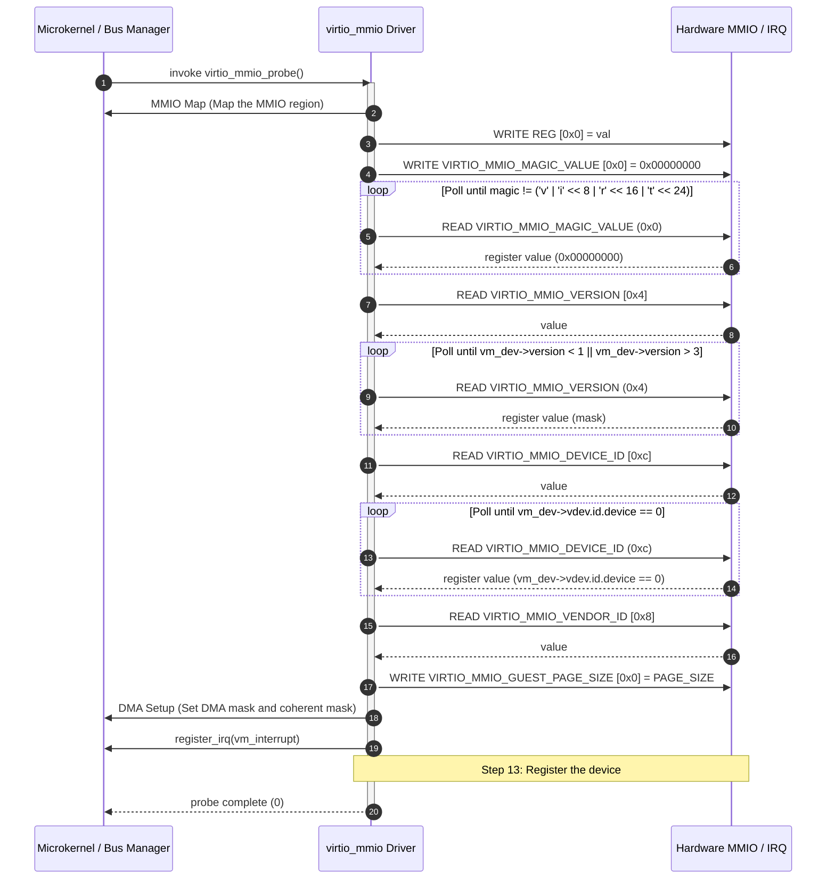
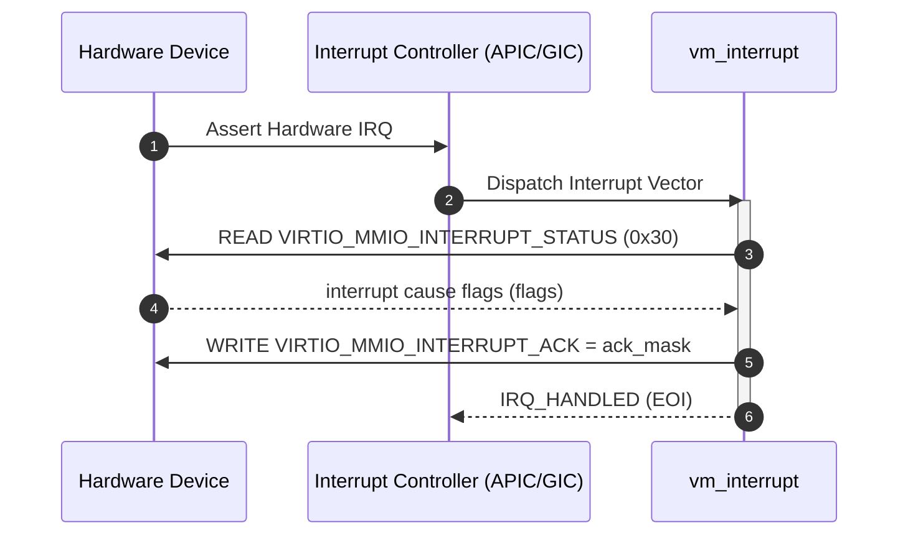

# Hardware & Driver Specification: Virtio MMIO Controller

> **Linux Driver Module:** `virtio_mmio` | **Bus Type:** `MMIO` | **Endianness:** `little`

---

## 1. Summary & Hardware Identification

Platform bus driver for memory mapped virtio devices

- **Driver Module:** `virtio_mmio`
- **Device Name:** Virtio MMIO Controller
- **License / Author:** GPL — Pawel Moll <pawel.moll@arm.com>- **Primary Driver Structs:** `platform_driver`, `of_device_id`, `acpi_device_id`- **Probe / Remove Entry Points:** `virtio_mmio_probe` / `virtio_mmio_remove`

### Compatible Hardware Nodes & Device IDs

| Match Source | Identifier / Compatible String | Vendor ID | Device ID |
| :--- | :--- | :--- | :--- |
| Device Tree (`of_device_id`) | `virtio,mmio` | — | — |

### MMIO / BAR Base Address Regions

| Region ID | Name | Base Offset | Size Hint | Description |
| :--- | :--- | :--- | :--- | :--- |
| `0` | MMIO Region | `0x0` | 0x1000 | Memory-mapped I/O region for Virtio MMIO |

---

## 2. Register Memory Map

| Register Name | Offset | Offset Formula | Width | Access | Reset Value | Description |
| :--- | :--- | :--- | :--- | :--- | :--- | :--- |
| `VIRTIO_MMIO_MAGIC_VALUE` | `0x0` | — | 32-bit | `RO` | `0x0` | Magic value to identify the device |
| `VIRTIO_MMIO_VERSION` | `0x4` | — | 32-bit | `RO` | `0x0` | Device version |
| `VIRTIO_MMIO_VENDOR_ID` | `0xc` | — | 32-bit | `RO` | `0x0` | Vendor ID |
| `VIRTIO_MMIO_DEVICE_ID` | `0x8` | — | 32-bit | `RO` | `0x0` | Device ID |
| `VIRTIO_MMIO_QUEUE_SEL` | `0x30` | — | 32-bit | `RW` | `0x0` | Select a specific queue |
| `VIRTIO_MMIO_QUEUE_NUM_MAX` | `0x34` | — | 32-bit | `RO` | `0x0` | Maximum number of descriptors in the queue |
| `VIRTIO_MMIO_QUEUE_NUM` | `0x38` | — | 32-bit | `RW` | `0x0` | Number of descriptors in the queue |
| `VIRTIO_MMIO_QUEUE_ALIGN` | `0x3c` | — | 32-bit | `RW` | `0x0` | Alignment of the queue |
| `VIRTIO_MMIO_QUEUE_PFN` | `0x40` | — | 32-bit | `RW` | `0x0` | Physical frame number of the queue descriptor table |
| `VIRTIO_MMIO_QUEUE_AVAIL` | `0x24` | — | 32-bit | `RW` | `0x0` | Queue available ring |
| `VIRTIO_MMIO_QUEUE_USED` | `0x28` | — | 32-bit | `RW` | `0x0` | Queue used ring |
| `VIRTIO_MMIO_QUEUE_READY` | `0x44` | — | 32-bit | `RW` | `0x0` | Queue readiness |
| `VIRTIO_MMIO_INTERRUPT_STATUS` | `0x60` | — | 32-bit | `RO` | `0x0` | Interrupt status |
| `VIRTIO_MMIO_INTERRUPT_ACK` | `0x64` | — | 32-bit | `WO` | `0x0` | Interrupt acknowledge |
| `VIRTIO_MMIO_DEVICE_FEATURES` | `0x10` | — | 32-bit | `RW` | `0x0` | Device features |
| `VIRTIO_MMIO_DEVICE_FEATURES_SEL` | `0x14` | — | 32-bit | `RW` | `0x0` | Device features selection |
| `VIRTIO_MMIO_DRIVER_FEATURES` | `0x20` | — | 32-bit | `RW` | `0x0` | Driver features |
| `VIRTIO_MMIO_DRIVER_FEATURES_SEL` | `0x24` | — | 32-bit | `RW` | `0x0` | Driver features selection |
| `VIRTIO_MMIO_QUEUE_NOTIFY` | `0x50` | — | 32-bit | `WO` | `0x0` | Queue notification |
| `VIRTIO_MMIO_SHM_SEL` | `0xac` | — | 32-bit | `RW` | `0x0` | Shared memory region selection |
| `VIRTIO_MMIO_SHM_LEN_LOW` | `0xb0` | — | 32-bit | `RO` | `0x0` | Shared memory region length (low) |
| `VIRTIO_MMIO_SHM_LEN_HIGH` | `0xb4` | — | 32-bit | `RO` | `0x0` | Shared memory region length (high) |
| `VIRTIO_MMIO_SHM_BASE_LOW` | `0xb8` | — | 32-bit | `RO` | `0x0` | Shared memory region base address (low) |
| `VIRTIO_MMIO_SHM_BASE_HIGH` | `0xbc` | — | 32-bit | `RO` | `0x0` | Shared memory region base address (high) |
| `VIRTIO_MMIO_CONFIG` | `0x100` | — | 32-bit | `RW` | `0x0` | Configuration space |
| `VIRTIO_MMIO_STATUS` | `0x70` | — | 32-bit | `RW` | `0x0` | Device status |

### Bitfield Definitions

#### `VIRTIO_MMIO_MAGIC_VALUE` (`0x0`)

| Bitfield | Bits | Mask / Macro | Access | Reset | Description |
| :--- | :--- | :--- | :--- | :--- | :--- |
| `VIRTIO_MAGIC_VALUE` | `0` | `0x00000000` | `RO` | `—` | Magic value for identification |
#### `VIRTIO_MMIO_VERSION` (`0x4`)

| Bitfield | Bits | Mask / Macro | Access | Reset | Description |
| :--- | :--- | :--- | :--- | :--- | :--- |
| `VIRTIO_VERSION` | `0:7` | `0x000000ff` | `RO` | `—` | Device version number |
#### `VIRTIO_MMIO_VENDOR_ID` (`0xc`)

| Bitfield | Bits | Mask / Macro | Access | Reset | Description |
| :--- | :--- | :--- | :--- | :--- | :--- |
| `VIRTIO_VENDOR_ID` | `0:31` | `0xffffffff` | `RO` | `—` | Vendor ID for the device |
#### `VIRTIO_MMIO_DEVICE_ID` (`0x8`)

| Bitfield | Bits | Mask / Macro | Access | Reset | Description |
| :--- | :--- | :--- | :--- | :--- | :--- |
| `VIRTIO_DEVICE_ID` | `0:31` | `0xffffffff` | `RO` | `—` | Device ID for the device |
#### `VIRTIO_MMIO_QUEUE_SEL` (`0x30`)

| Bitfield | Bits | Mask / Macro | Access | Reset | Description |
| :--- | :--- | :--- | :--- | :--- | :--- |
| `VIRTIO_QUEUE_SEL` | `0:7` | `0x000000ff` | `RW` | `—` | Queue selection index |
#### `VIRTIO_MMIO_QUEUE_NUM_MAX` (`0x34`)

| Bitfield | Bits | Mask / Macro | Access | Reset | Description |
| :--- | :--- | :--- | :--- | :--- | :--- |
| `VIRTIO_QUEUE_NUM_MAX` | `0:31` | `0xffffffff` | `RO` | `—` | Maximum number of descriptors in the queue |
#### `VIRTIO_MMIO_QUEUE_NUM` (`0x38`)

| Bitfield | Bits | Mask / Macro | Access | Reset | Description |
| :--- | :--- | :--- | :--- | :--- | :--- |
| `VIRTIO_QUEUE_NUM` | `0:31` | `0xffffffff` | `RW` | `—` | Number of descriptors in the queue |
#### `VIRTIO_MMIO_QUEUE_ALIGN` (`0x3c`)

| Bitfield | Bits | Mask / Macro | Access | Reset | Description |
| :--- | :--- | :--- | :--- | :--- | :--- |
| `VIRTIO_QUEUE_ALIGN` | `0:31` | `0xffffffff` | `RW` | `—` | Alignment of the queue |
#### `VIRTIO_MMIO_QUEUE_PFN` (`0x40`)

| Bitfield | Bits | Mask / Macro | Access | Reset | Description |
| :--- | :--- | :--- | :--- | :--- | :--- |
| `VIRTIO_QUEUE_PFN` | `0:31` | `0xffffffff` | `RW` | `—` | Physical frame number of the queue descriptor table |
#### `VIRTIO_MMIO_QUEUE_AVAIL` (`0x24`)

| Bitfield | Bits | Mask / Macro | Access | Reset | Description |
| :--- | :--- | :--- | :--- | :--- | :--- |
| `VIRTIO_QUEUE_AVAIL` | `0:31` | `0xffffffff` | `RW` | `—` | Queue available ring |
#### `VIRTIO_MMIO_QUEUE_USED` (`0x28`)

| Bitfield | Bits | Mask / Macro | Access | Reset | Description |
| :--- | :--- | :--- | :--- | :--- | :--- |
| `VIRTIO_QUEUE_USED` | `0:31` | `0xffffffff` | `RW` | `—` | Queue used ring |
#### `VIRTIO_MMIO_QUEUE_READY` (`0x44`)

| Bitfield | Bits | Mask / Macro | Access | Reset | Description |
| :--- | :--- | :--- | :--- | :--- | :--- |
| `VIRTIO_QUEUE_READY` | `0:31` | `0xffffffff` | `RW` | `—` | Queue readiness |
#### `VIRTIO_MMIO_INTERRUPT_STATUS` (`0x60`)

| Bitfield | Bits | Mask / Macro | Access | Reset | Description |
| :--- | :--- | :--- | :--- | :--- | :--- |
| `VIRTIO_INT_STATUS` | `0:31` | `0xffffffff` | `RO` | `—` | Interrupt status bits |
#### `VIRTIO_MMIO_INTERRUPT_ACK` (`0x64`)

| Bitfield | Bits | Mask / Macro | Access | Reset | Description |
| :--- | :--- | :--- | :--- | :--- | :--- |
| `VIRTIO_INT_ACK` | `0:31` | `0xffffffff` | `WO` | `—` | Interrupt acknowledge bits |
#### `VIRTIO_MMIO_DEVICE_FEATURES` (`0x10`)

| Bitfield | Bits | Mask / Macro | Access | Reset | Description |
| :--- | :--- | :--- | :--- | :--- | :--- |
| `VIRTIO_DEVICE_FEATURES` | `0:31` | `0xffffffff` | `RW` | `—` | Device features bits |
#### `VIRTIO_MMIO_DEVICE_FEATURES_SEL` (`0x14`)

| Bitfield | Bits | Mask / Macro | Access | Reset | Description |
| :--- | :--- | :--- | :--- | :--- | :--- |
| `VIRTIO_DEVICE_FEATURES_SEL` | `0:31` | `0xffffffff` | `RW` | `—` | Device features selection index |
#### `VIRTIO_MMIO_DRIVER_FEATURES` (`0x20`)

| Bitfield | Bits | Mask / Macro | Access | Reset | Description |
| :--- | :--- | :--- | :--- | :--- | :--- |
| `VIRTIO_DRIVER_FEATURES` | `0:31` | `0xffffffff` | `RW` | `—` | Driver features bits |
#### `VIRTIO_MMIO_DRIVER_FEATURES_SEL` (`0x24`)

| Bitfield | Bits | Mask / Macro | Access | Reset | Description |
| :--- | :--- | :--- | :--- | :--- | :--- |
| `VIRTIO_DRIVER_FEATURES_SEL` | `0:31` | `0xffffffff` | `RW` | `—` | Driver features selection index |
#### `VIRTIO_MMIO_QUEUE_NOTIFY` (`0x50`)

| Bitfield | Bits | Mask / Macro | Access | Reset | Description |
| :--- | :--- | :--- | :--- | :--- | :--- |
| `VIRTIO_QUEUE_NOTIFY` | `0:31` | `0xffffffff` | `WO` | `—` | Queue notification index |
#### `VIRTIO_MMIO_SHM_SEL` (`0xac`)

| Bitfield | Bits | Mask / Macro | Access | Reset | Description |
| :--- | :--- | :--- | :--- | :--- | :--- |
| `VIRTIO_SHM_SEL` | `0:31` | `0xffffffff` | `RW` | `—` | Shared memory region selection index |
#### `VIRTIO_MMIO_SHM_LEN_LOW` (`0xb0`)

| Bitfield | Bits | Mask / Macro | Access | Reset | Description |
| :--- | :--- | :--- | :--- | :--- | :--- |
| `VIRTIO_SHM_LEN_LOW` | `0:31` | `0xffffffff` | `RO` | `—` | Shared memory region length (low) |
#### `VIRTIO_MMIO_SHM_LEN_HIGH` (`0xb4`)

| Bitfield | Bits | Mask / Macro | Access | Reset | Description |
| :--- | :--- | :--- | :--- | :--- | :--- |
| `VIRTIO_SHM_LEN_HIGH` | `0:31` | `0xffffffff` | `RO` | `—` | Shared memory region length (high) |
#### `VIRTIO_MMIO_SHM_BASE_LOW` (`0xb8`)

| Bitfield | Bits | Mask / Macro | Access | Reset | Description |
| :--- | :--- | :--- | :--- | :--- | :--- |
| `VIRTIO_SHM_BASE_LOW` | `0:31` | `0xffffffff` | `RO` | `—` | Shared memory region base address (low) |
#### `VIRTIO_MMIO_SHM_BASE_HIGH` (`0xbc`)

| Bitfield | Bits | Mask / Macro | Access | Reset | Description |
| :--- | :--- | :--- | :--- | :--- | :--- |
| `VIRTIO_SHM_BASE_HIGH` | `0:31` | `0xffffffff` | `RO` | `—` | Shared memory region base address (high) |
#### `VIRTIO_MMIO_CONFIG` (`0x100`)

| Bitfield | Bits | Mask / Macro | Access | Reset | Description |
| :--- | :--- | :--- | :--- | :--- | :--- |
| `VIRTIO_CONFIG` | `0:31` | `0xffffffff` | `RW` | `—` | Configuration space registers |
#### `VIRTIO_MMIO_STATUS` (`0x70`)

| Bitfield | Bits | Mask / Macro | Access | Reset | Description |
| :--- | :--- | :--- | :--- | :--- | :--- |
| `VIRTIO_STATUS` | `0:31` | `0xffffffff` | `RW` | `—` | Device status bits |

---

## 3. Sequence Diagrams

### 3.1 Initialization & Probe Lifecycle (`virtio_mmio_probe`)



### 3.2 Interrupt Handling Lifecycle (`vm_interrupt`)



---

## 4. Runtime Operations, DMA & Concurrency Model

### 4.1 Concurrency & Locking Primitives

| Linux Primitive | Abstract Lock Type | Protected Resources | Bare-Metal C++ Recommendation |
| :--- | :--- | :--- | :--- |
| `spin_lock_irqsave(&port->lock, flags)` | `IRQSafeSpinlock` | MMIO region | Use IRQ-safe spinlocks |

### 4.2 DMA & Memory Coherency

- **Allocation API:** `dma_alloc_coherent`
- **DMA Address Mask:** 64-bit
- **Descriptor Rings:** None
- **Memory Barriers & Coherency:** Barrier/coherency notes or null

---

## 5. C++ Microkernel Migration Notes

### 5.1 Linux Kernel to Bare-Metal C++ API Mapping

| Linux Kernel API | Bare-Metal C++ Microkernel Equivalent | Migration Notes |
| :--- | :--- | :--- |
| `readl / writel` | `MmioRegion::read32 / write32` | Bare-metal C++ porting note |

### 5.2 Architectural Caveats

- Important bare-metal porting caveat

### 5.3 Generated C++20 Bare-Metal Driver Skeleton

```cpp
#pragma once

#include <cstdint>
#include <cstddef>

namespace microkernel::drivers::virtio_mmio {

namespace regs {
    inline constexpr std::uintptr_t VIRTIO_MMIO_MAGIC_VALUE = 0x0; // 32-bit RO - Magic value to identify the device    inline constexpr std::uintptr_t VIRTIO_MMIO_VERSION = 0x4; // 32-bit RO - Device version    inline constexpr std::uintptr_t VIRTIO_MMIO_VENDOR_ID = 0xc; // 32-bit RO - Vendor ID    inline constexpr std::uintptr_t VIRTIO_MMIO_DEVICE_ID = 0x8; // 32-bit RO - Device ID    inline constexpr std::uintptr_t VIRTIO_MMIO_QUEUE_SEL = 0x30; // 32-bit RW - Select a specific queue    inline constexpr std::uintptr_t VIRTIO_MMIO_QUEUE_NUM_MAX = 0x34; // 32-bit RO - Maximum number of descriptors in the queue    inline constexpr std::uintptr_t VIRTIO_MMIO_QUEUE_NUM = 0x38; // 32-bit RW - Number of descriptors in the queue    inline constexpr std::uintptr_t VIRTIO_MMIO_QUEUE_ALIGN = 0x3c; // 32-bit RW - Alignment of the queue    inline constexpr std::uintptr_t VIRTIO_MMIO_QUEUE_PFN = 0x40; // 32-bit RW - Physical frame number of the queue descriptor table    inline constexpr std::uintptr_t VIRTIO_MMIO_QUEUE_AVAIL = 0x24; // 32-bit RW - Queue available ring    inline constexpr std::uintptr_t VIRTIO_MMIO_QUEUE_USED = 0x28; // 32-bit RW - Queue used ring    inline constexpr std::uintptr_t VIRTIO_MMIO_QUEUE_READY = 0x44; // 32-bit RW - Queue readiness    inline constexpr std::uintptr_t VIRTIO_MMIO_INTERRUPT_STATUS = 0x60; // 32-bit RO - Interrupt status    inline constexpr std::uintptr_t VIRTIO_MMIO_INTERRUPT_ACK = 0x64; // 32-bit WO - Interrupt acknowledge    inline constexpr std::uintptr_t VIRTIO_MMIO_DEVICE_FEATURES = 0x10; // 32-bit RW - Device features    inline constexpr std::uintptr_t VIRTIO_MMIO_DEVICE_FEATURES_SEL = 0x14; // 32-bit RW - Device features selection    inline constexpr std::uintptr_t VIRTIO_MMIO_DRIVER_FEATURES = 0x20; // 32-bit RW - Driver features    inline constexpr std::uintptr_t VIRTIO_MMIO_DRIVER_FEATURES_SEL = 0x24; // 32-bit RW - Driver features selection    inline constexpr std::uintptr_t VIRTIO_MMIO_QUEUE_NOTIFY = 0x50; // 32-bit WO - Queue notification    inline constexpr std::uintptr_t VIRTIO_MMIO_SHM_SEL = 0xac; // 32-bit RW - Shared memory region selection    inline constexpr std::uintptr_t VIRTIO_MMIO_SHM_LEN_LOW = 0xb0; // 32-bit RO - Shared memory region length (low)    inline constexpr std::uintptr_t VIRTIO_MMIO_SHM_LEN_HIGH = 0xb4; // 32-bit RO - Shared memory region length (high)    inline constexpr std::uintptr_t VIRTIO_MMIO_SHM_BASE_LOW = 0xb8; // 32-bit RO - Shared memory region base address (low)    inline constexpr std::uintptr_t VIRTIO_MMIO_SHM_BASE_HIGH = 0xbc; // 32-bit RO - Shared memory region base address (high)    inline constexpr std::uintptr_t VIRTIO_MMIO_CONFIG = 0x100; // 32-bit RW - Configuration space    inline constexpr std::uintptr_t VIRTIO_MMIO_STATUS = 0x70; // 32-bit RW - Device status} // namespace regs

class VirtioMmioDriver {
public:
    explicit VirtioMmioDriver(std::uintptr_t mmio_base) noexcept
        : mmio_base_(mmio_base) {}

    bool init() noexcept {
        // Implement ordered initialization steps from Section 3.1 (13 steps)
        return true;
    }

    void handle_irq() noexcept {
        const auto status = read32(regs::VIRTIO_MMIO_INTERRUPT_STATUS);
        (void)status;
        // Acknowledge interrupt (Write-1-to-clear ICR)
        write32(regs::VIRTIO_MMIO_INTERRUPT_ACK, status);
    }

private:
    [[nodiscard]] std::uint32_t read32(std::uintptr_t offset) const noexcept {
        return *reinterpret_cast<const volatile std::uint32_t*>(mmio_base_ + offset);
    }

    void write32(std::uintptr_t offset, std::uint32_t value) const noexcept {
        *reinterpret_cast<volatile std::uint32_t*>(mmio_base_ + offset) = value;
    }

    std::uintptr_t mmio_base_;
};

} // namespace microkernel::drivers::virtio_mmio
```
