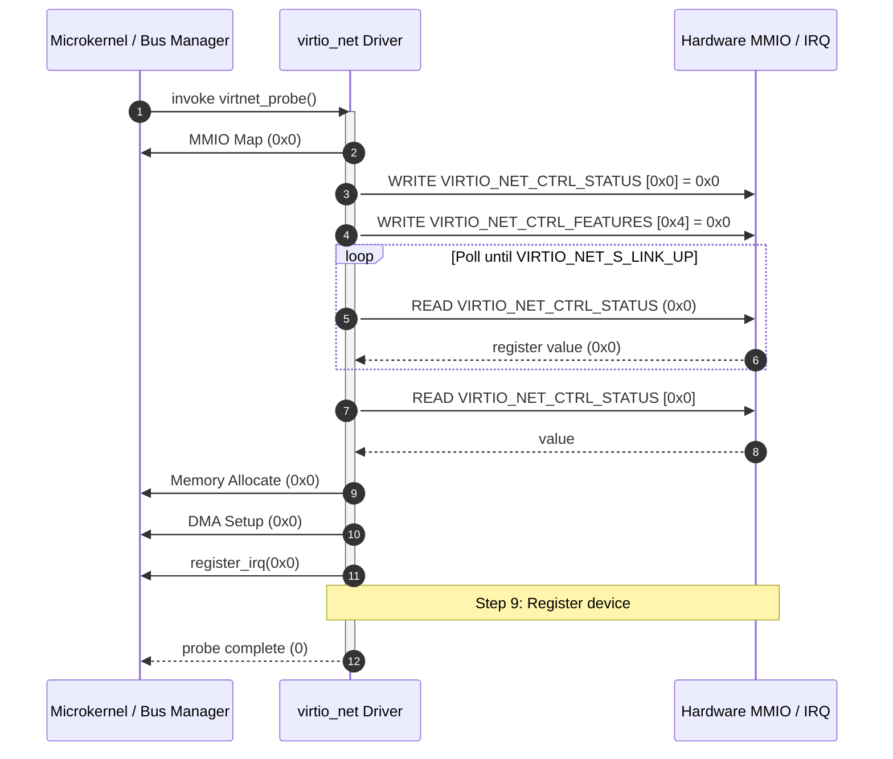
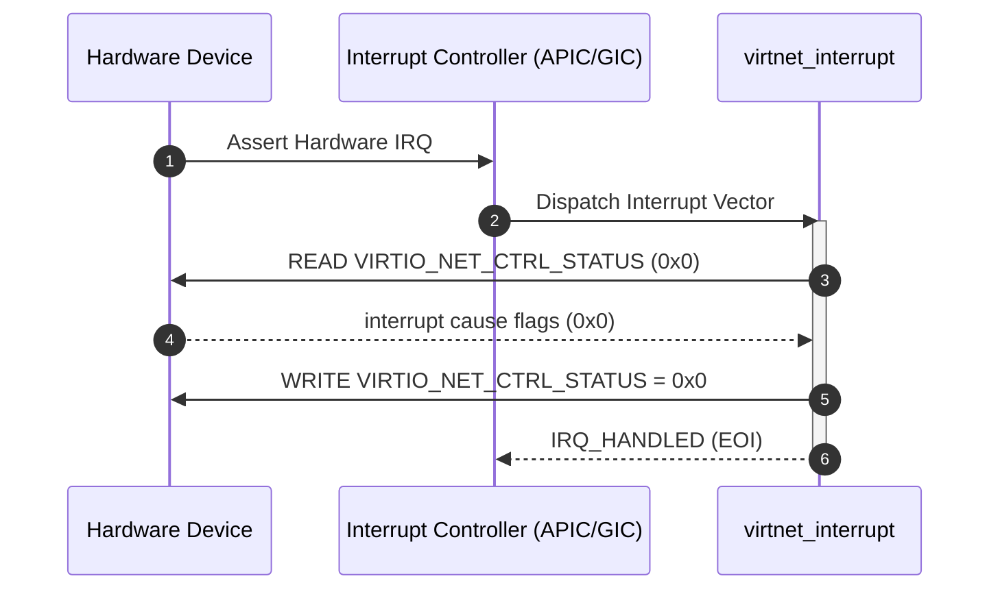

# Hardware & Driver Specification: Virtio Network

> **Linux Driver Module:** `virtio_net` | **Bus Type:** `MMIO` | **Endianness:** `little`

---

## 1. Summary & Hardware Identification

Virtio Network Driver

- **Driver Module:** `virtio_net`
- **Device Name:** Virtio Network
- **License / Author:** GPL — Linux Kernel Maintainers
- **Primary Driver Structs:** `net_device_ops`, `virtio_driver`, `send_queue`, `receive_queue`, `virtnet_info`
- **Probe / Remove Entry Points:** `virtnet_probe` / `virtnet_remove`

### Compatible Hardware Nodes & Device IDs

| Match Source | Identifier / Compatible String | Vendor ID | Device ID |
| :--- | :--- | :--- | :--- |
| Device Tree (`of_device_id`) | `virtio,net` | — | — |

### MMIO / BAR Base Address Regions

| Region ID | Name | Base Offset | Size Hint | Description |
| :--- | :--- | :--- | :--- | :--- |
| `0` | MMIO Region | `0x0` | 0x1000 | MMIO region for Virtio Network |

---

## 2. Register Memory Map

| Register Name | Offset | Offset Formula | Width | Access | Reset Value | Description |
| :--- | :--- | :--- | :--- | :--- | :--- | :--- |
| `VIRTIO_NET_CTRL_STATUS` | `0x0` | — | 32-bit | `RW` | `0x0` | Status register |
| `VIRTIO_NET_CTRL_FEATURES` | `0x4` | — | 32-bit | `RW` | `0x0` | Features register |
| `VIRTIO_NET_CTRL_MAC` | `0x1` | — | 32-bit | `RW` | `0x0` | MAC control register |
| `VIRTIO_NET_CTRL_STATS` | `0x8` | — | 32-bit | `RW` | `0x0` | Statistics control register |
| `VIRTIO_NET_CTRL_MQ` | `0x4` | — | 32-bit | `RW` | `0x0` | Multi-queue control register |
| `VIRTIO_NET_CTRL_RX` | `0x0` | — | 32-bit | `RW` | `0x0` | Receive control register |
| `VIRTIO_NET_CTRL_MAC_TABLE_SET` | `0x0` | — | 32-bit | `RW` | `0x0` | MAC table set register |
| `VIRTIO_NET_CTRL_NOTF_COAL` | `0x6` | — | 32-bit | `RW` | `0x0` | Notification coalescing control register |
| `VIRTIO_NET_CTRL_STATS_CVQ` | `0x20` | — | 32-bit | `RW` | `0x0` | Control virtqueue statistics register |

### Bitfield Definitions

#### `VIRTIO_NET_CTRL_STATUS` (`0x0`)

| Bitfield | Bits | Mask / Macro | Access | Reset | Description |
| :--- | :--- | :--- | :--- | :--- | :--- |
| `VIRTIO_NET_S_LINK_UP` | `0` | `BIT(0)` | `RW` | `—` | Link up status |
| `VIRTIO_NET_S_CONFIG_CHANGED` | `1` | `BIT(1)` | `RW` | `—` | Configuration changed |
#### `VIRTIO_NET_CTRL_FEATURES` (`0x4`)

| Bitfield | Bits | Mask / Macro | Access | Reset | Description |
| :--- | :--- | :--- | :--- | :--- | :--- |
| `VIRTIO_NET_F_CSUM` | `0` | `BIT(0)` | `RW` | `—` | Checksum offload support |
| `VIRTIO_NET_F_GSO` | `1` | `BIT(1)` | `RW` | `—` | Generic segmentation offload support |
| `VIRTIO_NET_F_RSS` | `2` | `BIT(2)` | `RW` | `—` | Receive side scaling support |
| `VIRTIO_NET_F_MQ` | `3` | `BIT(3)` | `RW` | `—` | Multi-queue support |
| `VIRTIO_NET_F_MRG_RXBUF` | `4` | `BIT(4)` | `RW` | `—` | Mergeable receive buffer support |
| `VIRTIO_NET_F_GUEST_CSUM` | `5` | `BIT(5)` | `RW` | `—` | Guest checksum offload support |
| `VIRTIO_NET_F_GUEST_TSO4` | `6` | `BIT(6)` | `RW` | `—` | Guest TSO4 support |
| `VIRTIO_NET_F_GUEST_TSO6` | `7` | `BIT(7)` | `RW` | `—` | Guest TSO6 support |
| `VIRTIO_NET_F_GUEST_ECN` | `8` | `BIT(8)` | `RW` | `—` | Guest ECN support |
| `VIRTIO_NET_F_GUEST_USO` | `9` | `BIT(9)` | `RW` | `—` | Guest USO support |
| `VIRTIO_NET_F_GUEST_UDP_TUNNEL_GSO` | `10` | `BIT(10)` | `RW` | `—` | Guest UDP tunnel GSO support |
| `VIRTIO_NET_F_HOST_TSO4` | `11` | `BIT(11)` | `RW` | `—` | Host TSO4 support |
| `VIRTIO_NET_F_HOST_TSO6` | `12` | `BIT(12)` | `RW` | `—` | Host TSO6 support |
| `VIRTIO_NET_F_HOST_ECN` | `13` | `BIT(13)` | `RW` | `—` | Host ECN support |
| `VIRTIO_NET_F_HOST_USO` | `14` | `BIT(14)` | `RW` | `—` | Host USO support |
| `VIRTIO_NET_F_HOST_UDP_TUNNEL_GSO` | `15` | `BIT(15)` | `RW` | `—` | Host UDP tunnel GSO support |
| `VIRTIO_NET_F_HOST_UDP_TUNNEL_GSO_CSUM` | `16` | `BIT(16)` | `RW` | `—` | Host UDP tunnel GSO checksum support |
| `VIRTIO_NET_F_GUEST_OFFLOADS` | `17` | `BIT(17)` | `RW` | `—` | Guest offload support |
| `VIRTIO_NET_F_CTRL_VQ` | `18` | `BIT(18)` | `RW` | `—` | Control virtqueue support |
| `VIRTIO_NET_F_MTU` | `19` | `BIT(19)` | `RW` | `—` | MTU support |
| `VIRTIO_NET_F_STANDBY` | `20` | `BIT(20)` | `RW` | `—` | Standby support |
| `VIRTIO_NET_F_NOTF_COAL` | `21` | `BIT(21)` | `RW` | `—` | Notification coalescing support |
| `VIRTIO_NET_F_VQ_NOTF_COAL` | `22` | `BIT(22)` | `RW` | `—` | Virtual queue notification coalescing support |
| `VIRTIO_NET_F_CTRL_RX` | `23` | `BIT(23)` | `RW` | `—` | Receive control support |
| `VIRTIO_NET_F_CTRL_VLAN` | `24` | `BIT(24)` | `RW` | `—` | VLAN control support |
| `VIRTIO_NET_F_CTRL_MAC_ADDR` | `25` | `BIT(25)` | `RW` | `—` | MAC address control support |
| `VIRTIO_NET_F_CTRL_GUEST_OFFLOADS` | `26` | `BIT(26)` | `RW` | `—` | Guest offload control support |
| `VIRTIO_NET_F_CTRL_GUEST_TSO4` | `27` | `BIT(27)` | `RW` | `—` | Guest TSO4 control support |
| `VIRTIO_NET_F_CTRL_GUEST_TSO6` | `28` | `BIT(28)` | `RW` | `—` | Guest TSO6 control support |
| `VIRTIO_NET_F_CTRL_GUEST_ECN` | `29` | `BIT(29)` | `RW` | `—` | Guest ECN control support |
| `VIRTIO_NET_F_CTRL_GUEST_USO` | `30` | `BIT(30)` | `RW` | `—` | Guest USO control support |
| `VIRTIO_NET_F_CTRL_GUEST_UDP_TUNNEL_GSO` | `31` | `BIT(31)` | `RW` | `—` | Guest UDP tunnel GSO control support |
#### `VIRTIO_NET_CTRL_MAC` (`0x1`)

| Bitfield | Bits | Mask / Macro | Access | Reset | Description |
| :--- | :--- | :--- | :--- | :--- | :--- |
| `VIRTIO_NET_CTRL_MAC_ADDR_SET` | `0` | `BIT(0)` | `RW` | `—` | Set MAC address |
| `VIRTIO_NET_CTRL_MAC_ADDR_GET` | `1` | `BIT(1)` | `RW` | `—` | Get MAC address |
#### `VIRTIO_NET_CTRL_STATS` (`0x8`)

| Bitfield | Bits | Mask / Macro | Access | Reset | Description |
| :--- | :--- | :--- | :--- | :--- | :--- |
| `VIRTIO_NET_CTRL_STATS_QUERY` | `0` | `BIT(0)` | `RW` | `—` | Query statistics |
| `VIRTIO_NET_CTRL_STATS_RESET` | `1` | `BIT(1)` | `RW` | `—` | Reset statistics |
#### `VIRTIO_NET_CTRL_MQ` (`0x4`)

| Bitfield | Bits | Mask / Macro | Access | Reset | Description |
| :--- | :--- | :--- | :--- | :--- | :--- |
| `VIRTIO_NET_CTRL_MQ_VQ_PAIRS_SET` | `0` | `BIT(0)` | `RW` | `—` | Set number of queue pairs |
| `VIRTIO_NET_CTRL_MQ_VQ_PAIRS_GET` | `1` | `BIT(1)` | `RW` | `—` | Get number of queue pairs |
#### `VIRTIO_NET_CTRL_RX` (`0x0`)

| Bitfield | Bits | Mask / Macro | Access | Reset | Description |
| :--- | :--- | :--- | :--- | :--- | :--- |
| `VIRTIO_NET_CTRL_RX_PROMISC` | `0` | `BIT(0)` | `RW` | `—` | Promiscuous mode |
| `VIRTIO_NET_CTRL_RX_ALLMULTI` | `1` | `BIT(1)` | `RW` | `—` | All multicast mode |
#### `VIRTIO_NET_CTRL_MAC_TABLE_SET` (`0x0`)

| Bitfield | Bits | Mask / Macro | Access | Reset | Description |
| :--- | :--- | :--- | :--- | :--- | :--- |
| `VIRTIO_NET_CTRL_MAC_TABLE_SET` | `0` | `BIT(0)` | `RW` | `—` | Set MAC table |
#### `VIRTIO_NET_CTRL_NOTF_COAL` (`0x6`)

| Bitfield | Bits | Mask / Macro | Access | Reset | Description |
| :--- | :--- | :--- | :--- | :--- | :--- |
| `VIRTIO_NET_CTRL_NOTF_COAL_TX_SET` | `0` | `BIT(0)` | `RW` | `—` | Set TX notification coalescing |
#### `VIRTIO_NET_CTRL_STATS_CVQ` (`0x20`)

| Bitfield | Bits | Mask / Macro | Access | Reset | Description |
| :--- | :--- | :--- | :--- | :--- | :--- |
| `VIRTIO_NET_CTRL_STATS_CVQ` | `0` | `BIT(0)` | `RW` | `—` | Control virtqueue statistics |

---

## 3. Sequence Diagrams

### 3.1 Initialization & Probe Lifecycle (`virtnet_probe`)



### 3.2 Interrupt Handling Lifecycle (`virtnet_interrupt`)



---

## 4. Runtime Operations, DMA & Concurrency Model

### 4.1 Concurrency & Locking Primitives

| Linux Primitive | Abstract Lock Type | Protected Resources | Bare-Metal C++ Recommendation |
| :--- | :--- | :--- | :--- |
| `spin_lock_irqsave(&port->lock, flags)` | `IRQSafeSpinlock` | Registers or ring buffers | Use IRQ-safe spinlocks |

### 4.2 DMA & Memory Coherency

- **Allocation API:** `dma_alloc_coherent`
- **DMA Address Mask:** 64-bit
- **Descriptor Rings:** None
- **Memory Barriers & Coherency:** Barrier/coherency notes or null

---

## 5. C++ Microkernel Migration Notes

### 5.1 Linux Kernel to Bare-Metal C++ API Mapping

| Linux Kernel API | Bare-Metal C++ Microkernel Equivalent | Migration Notes |
| :--- | :--- | :--- |
| `readl / writel` | `MmioRegion::read32 / write32` | Bare-metal C++ porting note |

### 5.2 Architectural Caveats

- Important bare-metal porting caveat

### 5.3 Generated C++20 Bare-Metal Driver Skeleton

```cpp
#pragma once

#include <cstdint>
#include <cstddef>

namespace microkernel::drivers::virtio_net {

namespace regs {
    inline constexpr std::uintptr_t VIRTIO_NET_CTRL_STATUS = 0x0; // 32-bit RW - Status register    inline constexpr std::uintptr_t VIRTIO_NET_CTRL_FEATURES = 0x4; // 32-bit RW - Features register    inline constexpr std::uintptr_t VIRTIO_NET_CTRL_MAC = 0x1; // 32-bit RW - MAC control register    inline constexpr std::uintptr_t VIRTIO_NET_CTRL_STATS = 0x8; // 32-bit RW - Statistics control register    inline constexpr std::uintptr_t VIRTIO_NET_CTRL_MQ = 0x4; // 32-bit RW - Multi-queue control register    inline constexpr std::uintptr_t VIRTIO_NET_CTRL_RX = 0x0; // 32-bit RW - Receive control register    inline constexpr std::uintptr_t VIRTIO_NET_CTRL_MAC_TABLE_SET = 0x0; // 32-bit RW - MAC table set register    inline constexpr std::uintptr_t VIRTIO_NET_CTRL_NOTF_COAL = 0x6; // 32-bit RW - Notification coalescing control register    inline constexpr std::uintptr_t VIRTIO_NET_CTRL_STATS_CVQ = 0x20; // 32-bit RW - Control virtqueue statistics register} // namespace regs

class VirtioNetDriver {
public:
    explicit VirtioNetDriver(std::uintptr_t mmio_base) noexcept
        : mmio_base_(mmio_base) {}

    bool init() noexcept {
        // Implement ordered initialization steps from Section 3.1 (9 steps)
        return true;
    }

    void handle_irq() noexcept {
        const auto status = read32(regs::VIRTIO_NET_CTRL_STATUS);
        (void)status;
        // Acknowledge interrupt (Write-1-to-clear ICR or Read-to-clear)
        write32(regs::VIRTIO_NET_CTRL_STATUS, status);
    }

private:
    [[nodiscard]] std::uint32_t read32(std::uintptr_t offset) const noexcept {
        return *reinterpret_cast<const volatile std::uint32_t*>(mmio_base_ + offset);
    }

    void write32(std::uintptr_t offset, std::uint32_t value) const noexcept {
        *reinterpret_cast<volatile std::uint32_t*>(mmio_base_ + offset) = value;
    }

    std::uintptr_t mmio_base_;
};

} // namespace microkernel::drivers::virtio_net
```
